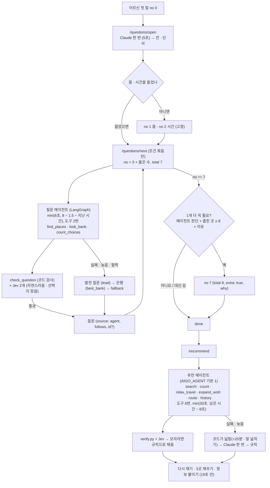

# REPORT — A `exp/agent-full` (질문 · 추천 전체를 에이전트가 이끌어요)

> 2026-11-21 · Claude · 브랜치 `exp/agent-full` (push 안 함) · 로컬 서버 포트 8011
> 시험용 말: `../SHARED_utterances.json` 20개 · 출발지 금호1가동 · 실측 도구 `docs/experiments/run_agent_full.py`

## 0. 한눈에

| 항목 | 결과 |
|---|---|
| 테스트 | `cd backend && uv run pytest -q` → **203 passed** (키 · DB 없이) |
| 질문 수 | 20개 말 모두 질문 7개 (no 0~6). 1개 더(no 7)는 1차 · 2차 모두 20개 중 **8번** |
| 앞 말을 이어 받은 질문 | 1차(키) **60 / 88 (68%)** · 2차(키, 최종 코드) **52 / 88 (59%)** · 키 없음 0 / 80 |
| 기본 질문(대신 길)으로 넘어간 비율 | 1차 **17 / 88 (19%)** · 2차 **24 / 88 (27%)** · 키 없음 80 / 80 (100%). 화면 기본 칸 질문(BASIC)까지 간 적은 0번 |
| 다시 물은 칸 | **0번** (세 실측 모두) |
| 질문 하나 걸린 시간 | 1차 평균 5.07초 · 최대 8.98초 (1번 넘음 → 고침) · 2차 평균 4.96초 · **최대 7.31초** · 키 없음 최대 0.27초 |
| 첫 말(`/questions/open`) | 평균 1.7~2.0초, 최대 4.27초. 서버 처음 뜰 때 19.06초였던 것 → **5.47초**로 고침 (4절) |
| 추천 `by` | 1차 agent 17 · ai 2 · rule 1 / 2차 agent 16 · ai 4 / 키 없음 rule 20 |
| 추천 걸린 시간 | 1차 평균 9.3초 · 최대 18.84초 · 2차 평균 11.8초 · 최대 18.84초 (한도 19초 안) · 키 없음 평균 8.0초 |
| 추천 3곳 | 1차 19/20 · 2차 16/20 (1~2곳만 나온 4번은 모두 고치기 전 1~15번). 고친 뒤(`a9d6eb5`) 키로 돌린 14번은 **모두 3곳** · 키 없음 20/20 |
| 매번 새로운 질문 | 같은 말 3개 × 3번: 서로 다른 질문 문장 키 **13/13 · 11/12 · 13/13**, 키 없음 **9/12 · 10/12 · 10/12** (6절) |

- 실측은 두 번 했어요. **1차**: 코드 `215d53c` (매번 새로운 질문 · 8초 끊기 · 3곳 채우기 전), 20개 모두 키. **2차**: 최종 질문 코드, 1~15는 12:00쯤 · 16~20은 다시(아래 ⚠️). 3곳 채우기(`a9d6eb5`)는 2차 16~20과 매번 새로운 질문 실측에만 들어갔어요.
- ⚠️ 2차 도중 터미널 환경 변수의 **다른 `ANTHROPIC_API_KEY`(크레딧 없음)**가 `backend/.env` 키보다 먼저 쓰여 400 `credit balance is too low`가 났어요 (`load_dotenv`는 override=False). 서버 · 실측을 `env -u ANTHROPIC_API_KEY`로 띄워 16~20 · 매번 새로운 질문 3×3을 다시 돌렸어요. 코드는 안 바꿨어요.

## 1. 구조

### 질문 7개가 정해지는 순서
1. **no 0 첫 말** — `/questions/open`이 Claude 한 번으로 칸(body · time · want · walk · inout)과 단서(place · who · wish)를 채워요 (지금 그대로).
2. **no 1 몸 · no 2 시간** — 첫 말에서 못 들은 것만 화면이 물어요. 들었으면 건너뛰고 그 번호는 "들은 것"으로 쳐요 (그래서 표의 질문 수가 6인 말이 있어요: 첫 말에 몸 상태가 있었음).
3. **no 3~6** — 모두 **질문 에이전트**가 정해요. 번호는 서버가 조건 묶음에서 세요: `no = 3 + len(ai) + (질문으로 채운 기본 칸 수)` (첫 말에서 들은 칸은 `filled`라 안 세요). 응답에 `no` · `total: 7`.
   - 에이전트는 매번 대화 · 채운 칸 · 오늘 후보 · 은행 질문(선택지마다 남는 곳 수)을 보고, 은행 질문을 쓸지 새로 만들지 스스로 정해요. 은행 질문을 그대로 쓰면 응답에 `id`(은행 id)가 붙어요.
   - "남은 질문 수"를 알려 주고, 마지막(no 6)에는 "후보를 가장 크게 가르는 질문"을 하라고 따로 적어요.
   - 에이전트가 `done`을 내도 질문 수는 7개를 채워요 → 발전 질문 · 은행의 더 좁히는 질문.
4. **no 7 (1개 더)** — no가 total(7)에 닿으면 에이전트에 "1개 더가 꼭 필요한지" 물어요. 응답은 `no: 7, total: 8, extra: true, why`. 대신 길(에이전트 실패 · 키 없음)에서는 묻지 않고 `done`.
5. 질문 no 8부터는 늘 `done`.

### "꼭 필요한 1개 더"의 기준
- 코드 문턱: 답한 주제로 좁힌 오늘 후보가 **8곳 이상** 남았을 때만 에이전트에 물어요 (`EXTRA_MIN_LEFT`). 8곳 미만이면 에이전트를 부르지도 않아요.
- 에이전트 판단: ① 좁혀도 후보가 많고 어르신 말의 핵심(가고 싶은 곳 · 하고 싶은 일)을 아직 하나로 못 좁혔을 때, ② 앞 답끼리 부딪힐 때 (예: 조용한 곳 + 축제). 아니면 `done`.
- 이유(`why`)가 비면 묻지 않아요. 이유는 응답 `why`와 로그(`질문 에이전트: 1개 더 물어요 (…)`)에 남아요.
- 실측에서 나온 이유 예: "사진 전시장 후보가 91곳으로 많아 구체적인 곳으로 좁혀야 함", "체험 후보가 21곳이라 한 곳으로 좁힐 마지막 질문이 필요해요". 묻지 않은 이유 예: "서울숲에서 손주랑 자전거 타기로 이미 좁혀졌어요", "좁힌 곳 6곳".

### AI를 부르는 곳 · 횟수 (말 하나, 키 있을 때)
| 곳 | 무엇 | 횟수 | 시간 한도 |
|---|---|---|---|
| `/questions/open` | Claude 한 번 (`OPEN_SYSTEM`) | 1 | 5초 |
| `/questions/next` no 3~6 | 질문 에이전트 (Claude 1~3번: 도구 2번까지) + Jev 2개 | 4 × (1~3) | min(6초, 8 − 1.5 − 지난 시간), 전체를 한 번 더 끊음 |
| no 7 판단 | 질문 에이전트 | 0~1 (좁힌 곳 ≥ 8일 때만) | 같음 |
| `/recommend` | 추천 에이전트 (Claude 1~7번) + `expand_wish`면 Claude 한 번 더 | 1 + α | min(30초, 19 − 지난 시간 − 8초) |
| `/recommend` 대신 길 | Claude 한 번 (`PICK_SYSTEM`), 코드 말 넓히기 Claude 한 번 | 0~2 | 6초 · 3.5초 |
- 실측 로그: 질문 에이전트는 거의 늘 **도구 0번**(첫 메시지에 찾은 곳 · 은행 표를 다 줘서 바로 제출), 추천 에이전트는 **도구 1번**(search_places)이 대부분이에요.

## 2. 자유로운 질문 — 무엇을 풀었나 (그리고 무엇을 남겼나)

| 막던 것 | 이 버전 |
|---|---|
| 프롬프트가 "단서가 있으면 이어서 좁히기" 한 줄 + 칸(걷기 · 실내외) 목록 위주 | 프롬프트 맨 위에 **"어르신 말과 바로 앞 답을 이어 받아 물어"**, 좋은 예(공룡 → 손주 → 화석) · 나쁜 예(실내외 · 걷기 칸 묻기)를 넣었어요. "이어 받을 말"(바로 앞 답 → 단서 → 같이 가는 사람)을 따로 줘요 |
| 선택지는 장소 이름 · 주제 이름 · 은행 선택지 · 빈 칸 선택지만 | **그 말로 오늘 갈 곳이 찾아지면** 자유 선택지도 돼요 (주제 낱말 또는 이름 BM25 점수 ≥ 2). 예: "만들기 체험", "한강", "화석 전시". 에이전트가 미리 재 볼 수 있게 `count_choices` 도구를 더했어요 |
| 질문 25자 | **32자** ("한강 쪽이 좋으세요, 꽃 · 정원 쪽이 좋으세요?" 같은 이어 묻기) |
| 은행 질문을 쓰면 말만 다듬은 것도 검사에서 탈락하기 쉬움 | 은행 질문(또는 그 다른 말투)이면 은행 선택지로 바로 통과 |
| 질문 수 최대 3개 (`MAX_AI_QUESTIONS`) · 에이전트 `done`이면 끝 | 질문 수 고정 7개. `done`이어도 더 좁히는 질문으로 채움 |
| 앞 답과 상관없이 같은 칸 순서 | 이어 받은 말을 코드가 확인해 응답 `follows`에 적어요 (리포트 숫자도 이걸로 셈) |

**남긴 것 (안전)**: 몸 · 건강 · 이름 · 나이 · 주소 · 연락처 낱말 금지(`BANNED` + `BODY_WORDS`), 한 문장 · 물음표 하나, 선택지 2~4개 · 14자, **오늘 후보에 근거가 있는 선택지만**, 장소 이름 선택지는 그 단서로 찾은 곳만, Jev 2개(자연스러움 0.6 · 선택지 맞음 0.35), walk · inout 칸 질문은 은행 문장 · 선택지 그대로.
**새로 막은 것**: 첫 말 · 앞 답으로 채운 칸을 **다른 말로** 다시 묻기 (inout을 들었는데 "바깥에서 …?", 걷기를 들었는데 "걸으면서 …?"), 앞에서 고른 답 · 처음 말의 바람을 선택지로 다시 내기, 앞 질문과 같은 선택지 묶음 (1차 실측에서 "서울숲에서 손주랑 무엇을 더 …?"가 두 번 나온 것).
**여전히 못 하는 것**: "손주는 몇 살쯤이에요?"처럼 오늘 후보에 근거가 없는 대화형 질문. 근거 규칙을 지키려고 막아 뒀어요 (알려진 문제 5번).

## 3. 추천 에이전트 — 조건 넓혀 다시 찾기 + 고르기
- `AIGO_AGENT` 기본값을 **이 브랜치에서만 1**로 (끄려면 `0`). `/health.agent`가 그대로 보여요.
- 새 도구: `relax_travel`(편도 상한 +20분), `expand_wish`(바람을 다른 말로 — `recommend/expand.py`를 그대로 불러요, 서울 시설 이름은 카카오로 확인), `count_places`(곳 수만, 찾기 횟수 안 씀).
- 넓히기는 **규칙만으로 0곳이거나 바람과 맞는 곳이 없을 때만** 돼요 (아니면 도구가 오류 글을 돌려줘요). 첫 메시지에 "넓혀 찾기" 안내가 붙어요.
- 넓혔으면 응답의 기존 칸으로 알려요: 이동 범위를 넓혀 고른 곳이 보이면 `"relaxed": true`, 말을 넓혔으면 `"expanded": {from, words, places, found}`.
- 에이전트가 실패 · 늦음이면 코드가 예전처럼 넓혀요 (0곳 → +20분, 바람 없음 → AI 한 번 말 넓히기, 단 Claude 한 번 호출 자리가 남을 때만) → Claude 한 번 → 규칙.
- 고른 곳의 이유는 `verify.py` · Jev 그대로. 모자라면 규칙으로 채우고, **재서 빠진 자리는 남은 시간에 몇 곳 더 재서 3곳을 채워요** (2차 실측 4/15번이 1~2곳만 나와서 고침, `a9d6eb5`).
- 실측: 1차에서 말 넓히기를 에이전트가 직접 한 건 공룡(시범 실행: 자연사 · 화석 · 과학관 …로 넓혀 서울시립과학관 · 서울하수도과학관), 2차에서 1번 (`expanded` 1). 시험용 말에는 0곳인 경우가 없어 `relaxed`는 실측에 안 나왔고, 테스트(가짜 LLM)로 확인했어요.

## 4. 시간 한도 · 첫 말 19초 문제
- **원인**: 이 컴퓨터(Windows)에서 처음 `import anthropic`이 **12.1초**, `langchain_anthropic`이 **13.5초** 걸렸어요 (`python -X importtime`). 두 줄 다 첫 요청 **안에서** 불러와서 `wait_for` 시간 한도 **밖**에서 막혔어요 → 첫 `/questions/open` 19.06초 (두 번째부터 1.8초).
- **고침** (`8e6a525`): 서버가 뜰 때 뒤 스레드에서 미리 불러요 (`app/llm/warm.py`, FastAPI lifespan). `ask_json` · `agent_loop.run`은 남은 시간만큼만 준비를 기다리고, 못 기다리면 AI 없이 대신 길로 가요.
- **결과**: 서버를 띄우자마자 첫 말을 보내면 **5.47초**에 답해요 (화면 OPEN_FAIL 7초 안). 이때는 라이브러리 준비(11.8~13.3초) 전이라 첫 말 AI 해석은 건너뛰고(`heard` 빈 목록) 질문은 몸 · 시간부터 물어요. 준비가 끝난 뒤로는 평균 1.7~2.0초.
- **질문 8초**: 1차에서 한 번 8.98초 → 에이전트 시간을 `min(6초, 8 − 1.5 − 지난 시간)`으로, 그리고 에이전트 전체(도구 · Jev 포함)를 그 한도에서 한 번 더 끊어요 (`7f5bbcc`, `215d53c`, `f508c53`). 2차 최대 **7.0초**.
- **추천 20초**: 사람이 정한 대로 화면 대기 20초 − 1초(19초) 안. 실측 최대 18.84초 (에이전트가 늦어 Claude 한 번으로 간 경우). 추천 에이전트 "시간 안에 안 끝남"이 1차 20번 중 8번, 2차 · 매번 새로운 질문 실측 29번 중 6번 (대신 길 = Claude 한 번 → 규칙으로 감).

## 5. 바꾼 파일 · 새 환경 변수

| 파일 | 무엇 |
|---|---|
| `backend/app/config.py` | `question_total()`, `QUESTION_FIXED` 3, `QUESTION_MAX_LEN` 32, `QUESTION_SCREEN` 8 · `QUESTION_SCREEN_MARGIN` 1.5, `EXTRA_MIN_LEFT` 8, `agent_on()` 기본 1 |
| `backend/app/question/agent.py` | 프롬프트 새로, 번호 세기 · 이어 받을 말 · 좁힌 곳 수 · 1개 더, `count_choices` 도구, 검사 풀기 · 다시 묻기 막기, `follows` |
| `backend/app/question/service.py` | `next_ai`: 번호 · total · extra, 에이전트 → 발전 → (한 번 호출) → 은행 순서, 8초 한도 끊기, 최근 질문 기억 |
| `backend/app/question/flow.py` | `next_step` no 3~6 + `total`, `BANK_ALT`(다른 말투) · `bank_id_of` |
| `backend/app/question/lead.py` | 발전 질문 말투 두 가지 · 이름 순서 섞기 |
| `backend/app/question/variety.py` (새) | 매번 새로운 질문 (최근 50개 기억 · 각도 · 말투 고르기 · 섞기) |
| `backend/app/recommend/agent/tools.py` · `graph.py` · `prompts.py` | 넓히기 도구 3개, 넓혀 찾기 안내, `info`로 relaxed · expanded 돌려줌 |
| `backend/app/recommend/service.py` | 에이전트가 넓히기를 맡고 실패 때만 코드가 넓힘, 3곳 채우기 |
| `backend/app/llm/warm.py` (새) · `client.py` · `agent_loop.py` · `main.py` | 라이브러리 미리 불러오기 |
| `backend/tests/` | `test_question_seven.py` · `test_question_variety.py` · `test_recommend_widen.py` · `test_warm.py` (새), 기존 테스트 바뀐 동작에 맞춤 |
| `docs/experiments/run_agent_full.py` · `results_agent-full_*.json` · 이 파일 | 실측 도구 · 결과 |

| 환경 변수 | 기본값 | 뜻 |
|---|---|---|
| `AIGO_QUESTION_TOTAL` | `7` | 질문 수 (첫 말 · 몸 · 시간 포함, 4~12) |
| `AIGO_AGENT` | **`1` (이 브랜치만)** | 추천 에이전트. `0`이면 한 번 호출 → 규칙 |
| `AIGO_QUESTION_VARIETY` | `1` | 매번 새로운 질문. `0`이면 늘 같은 질문 (시연용) |
| `AIGO_QUESTION_SEED` | 없음 | 매번 새로운 질문의 씨앗 (시험 고정용) |
- API 모양: 칸을 **더하기만** 했어요 — 질문 응답에 `total`, 1개 더에 `extra` · `why`, 에이전트 질문에 `follows`(이어 받은 말) · `id`(은행 질문을 썼을 때), `fallback` 응답에 `no` · `total`. 뺀 칸 없음, `frontend/` 안 고침.

## 6. 매번 새로운 질문 (`AIGO_QUESTION_VARIETY`)
- 서버 메모리에 최근 질문 50개 (DB 안 씀, 서버가 다시 뜨면 비어요). 질문 에이전트에는 "최근에 낸 질문" · "이번 각도"(6가지 중 하나) · "같은 뜻이어도 말투 · 순서를 바꿔요, 은행 질문도 바꿔 말해도 돼요"를 줘요 — AI 호출 수 · 시간은 그대로예요.
- 대신 길(키 없음 · 에이전트 실패)은 은행 질문의 다른 말투(`BANK_ALT`, 은행마다 2개) 중 최근에 덜 쓴 것 + 선택지 순서 섞기(고르지 않는 답은 맨 뒤), 발전 질문도 말투 두 가지 + 이름 순서 섞기.
- 다른 말투도 같은 은행 질문으로 알아봐서 "이미 물은 질문" · 답 → 주제 맞추기가 그대로 돼요. walk · inout 칸 질문은 화면(BASIC)과 같게 고정이에요.

| 같은 말 × 3번 (질문 no 3~, 1개 더 포함) | 키 있음 (최종 코드) | 키 없음 (최종 코드) |
|---|---|---|
| 손주랑 자전거 타고 싶어 | 서로 다른 문장 **13 / 13** | **9 / 12** |
| 손주랑 공룡 보러 가고 싶어 | **11 / 12** | **10 / 12** |
| 잘 모르겠어 | **13 / 13** | **10 / 12** |
- 키 있음 예 (자전거, 1번째 → 2번째 → 3번째 실행의 no 3): "손주랑 자전거는 어디서 타면 좋을까요?" → "손주랑 자전거는 어느 쪽이 끌리세요?" → "손주랑 자전거 타고 어디로 가 볼까요?" — 뜻은 같고 말투가 바뀌었어요.
- 키 없음에서 같은 문장이 남는 까닭: walk · inout 칸 질문은 일부러 고정이고, 은행 다른 말투가 2개씩이라 3번째에는 겹칠 수 있어요.
- 결과 파일: `results_agent-full_variety_key.json` · `results_agent-full_variety_nokey.json`

## 7. 시험용 말마다 결과

- 질문 수는 no 0(첫 말)부터 센 수예요. 첫 말에서 몸 · 시간을 들으면 no 1 · 2를 건너뛰어서 6이 돼요. 8이면 1개 더(no 7)를 물은 거예요.
- "이어 받은 질문"은 응답 `follows`가 있거나 발전 질문(`lead`)인 질문 수예요. 답은 늘 첫 선택지를 골랐어요 (`run_agent_full.py`).
- "다시 물은 칸"은 첫 말에서 들은 칸(`filled`)을 칸 질문이나 같은 뜻의 말(실내 · 바깥 · 걷기 · 누구)로 다시 물었는지예요.
- 화면의 질문 3개 제한(`MAX_FLEX_QUESTIONS`)은 따르지 않고 7개를 끝까지 돌렸어요 (알려진 문제 1번).

### 2차 키 실측 (최종 코드, 20개) — /health: {'ai': True, 'jev': False, 'agent': True, 'question': 'graph'}

| # | 첫 말 | 들은 것 | 질문 수 (no 0~) | 이어 받은 질문 / no 3~ | 에이전트 질문 | 1개 더 | 다시 물은 칸 | 첫 말 초 | 질문 최대 초 | 추천 by | 추천 초 | 넓힘 |
|---|---|---|---|---|---|---|---|---|---|---|---|---|
| 1 | 손주랑 자전거 타고 싶어 | 손주랑 · 자전거 타기 · 바깥 | 7 | 4 / 4 | 4 | - | 없음 | 2.58 | 4.39 | agent | 11.84 | - |
| 2 | 무릎이 아파서 많이 못 걸어 | 몸 무거움 · 조금만 걷기 | 7 | 2 / 5 | 2 | 예 | 없음 | 1.81 | 6.91 | agent | 12.67 | - |
| 3 | 손주랑 공룡 보러 가고 싶어 | 손주랑 · 공룡 구경 · 구경하기 · 실내 | 7 | 4 / 4 | 4 | - | 없음 | 1.84 | 6.48 | ai | 16.88 | - |
| 4 | 조용히 책 읽을 데 | 책 읽기 · 조용히 쉬기 | 7 | 2 / 4 | 4 | - | 없음 | 1.77 | 5.42 | agent | 12.91 | expanded: 도서관, 북카페, 책방, 서점, 독서, 문학관 |
| 5 | 맛있는 거 먹고 싶어 | 맛있는 것 | 8 | 1 / 5 | 3 | 예 | 없음 | 1.88 | 6.19 | agent | 9.78 | - |
| 6 | 잘 모르겠어 | - | 7 | 2 / 4 | 2 | - | 없음 | 1.76 | 6.27 | agent | 9.58 | - |
| 7 | 요새 허리가 안 좋아서 오래 앉아 있긴 힘들어 | 몸 무거움 | 6 | 2 / 4 | 3 | - | 없음 | 1.91 | 4.59 | agent | 9.03 | - |
| 8 | 우리 손녀딸이 초등학생인데 맘껏 뛸 곳이 있을까 | 손주랑 · 맘껏 뛰어놀기 · 바깥 | 7 | 4 / 4 | 4 | - | 없음 | 1.73 | 5.94 | agent | 6.81 | - |
| 9 | 비도 오는데 따뜻한 국물이나 파전 먹으러 갈까 | 국물 요리 · 파전 먹기 · 맛있는 것 · 실내 | 8 | 3 / 5 | 3 | 예 | 없음 | 1.89 | 7.0 | agent | 14.11 | - |
| 10 | 사람 많은 데는 정신사나워. 좀 한적한 공원 같은 데가 좋아 | 공원 | 7 | 4 / 4 | 3 | - | 없음 | 3.27 | 6.69 | ai | 18.56 | - |
| 11 | 남산타워 쪽으로 한번 가보고 싶은데 | 남산타워 | 8 | 3 / 5 | 5 | 예 | 없음 | 1.75 | 6.66 | agent | 8.05 | - |
| 12 | 오늘은 복권이라도 한 장 사야겠어 | - | 7 | 2 / 4 | 3 | - | 없음 | 1.84 | 4.53 | agent | 6.91 | - |
| 13 | 산책 | 바람 쐬기 | 7 | 2 / 4 | 3 | - | 없음 | 1.83 | 5.92 | agent | 7.38 | - |
| 14 | 햇볕 쐬면서 걷고 싶은데 바람은 좀 차네 | 바람 쐬기 | 7 | 2 / 4 | 3 | - | 없음 | 1.84 | 5.34 | agent | 7.94 | - |
| 15 | 동대문 시장 가서 구경이나 할까 | 동대문 시장 · 시장 구경 · 구경하기 | 8 | 2 / 5 | 1 | 예 | 없음 | 1.62 | 5.7 | agent | 7.72 | - |
| 16 | 손주 녀석 돈가스 사주고 싶어 | 손주랑 · 맛있는 것 | 7 | 3 / 4 | 4 | - | 없음 | 2.58 | 6.16 | ai | 16.73 | - |
| 17 | 절 같은 데 가서 가만히 앉아 있고 싶네 | 절 · 조용히 쉬기 | 8 | 2 / 5 | 4 | 예 | 없음 | 1.5 | 6.69 | agent | 12.84 | - |
| 18 | 요즘은 테레비에 나오는 트로트가 참 재밌어 | 트로트 구경 · 실내 | 8 | 4 / 5 | 4 | 예 | 없음 | 1.84 | 6.06 | ai | 18.84 | - |
| 19 | 카페 | - | 8 | 3 / 5 | 3 | 예 | 없음 | 0.92 | 6.97 | agent | 13.84 | - |
| 20 | 눈이 침침해서 너무 밝은 곳은 피하고 싶어 | - | 7 | 1 / 4 | 2 | - | 없음 | 4.27 | 7.31 | agent | 14.47 | - |

이어 받은 질문 합계: **52 / 88**

말마다 질문 · 추천 3곳

**1. 손주랑 자전거 타고 싶어**

- no 1 [fixed] 컨디션은 어떠세요? () → **보통이에요**
- no 2 [fixed] 얼마나 나가 계실 건가요? () → **한나절**
- no 3 [agent 4.17초] 손주랑 자전거는 어디서 타고 싶으세요? (서울숲 / 뚝섬한강공원 / 여의도한강공원 / 망원한강공원) → **서울숲** — 이어 받음: 자전거 타기
- no 4 [agent 4.0초] 서울숲에서 손주랑 자전거 말고 또 뭘 하실래요? (물가 구경 / 숲길 걷기 / 만들기 체험) → **물가 구경** — 이어 받음: 서울숲
- no 5 [agent 4.39초] 물가에서 손주랑 무엇을 해 보고 싶으세요? (강바람 쐬며 쉬기 / 자전거 더 타기 / 물가 걸으며 구경) → **강바람 쐬며 쉬기** — 이어 받음: 물가 구경
- no 6 [agent 4.34초] 강바람 쐬며 쉴 곳은 어디가 좋으세요? (뚝섬한강공원 / 여의도한강공원 / 망원한강공원 / 양화한강공원) → **뚝섬한강공원** — 이어 받음: 강바람 쐬며 쉬기
  - 추천: 서울숲 (43분) — 바람 쐬기 좋은 곳이에요. 한 번만 갈아타고 43분이면 가요
  - 추천: 뚝섬한강공원 (52분) — 바람 쐬기 좋은 곳이에요. 한 번만 갈아타고 52분이면 가요
  - 추천: 응봉공원 (대현산배수지공원) (16분) — 바람 쐬기 좋은 곳이에요. 역에서 바로 걸어가요

**2. 무릎이 아파서 많이 못 걸어**

- no 2 [fixed] 얼마나 나가 계실 건가요? () → **한나절**
- no 3 [fixed 6.91초] 어떤 경치를 보고 싶으세요? (물가 / 탁 트인 광장 / 숲길) → **물가**
- no 4 [agent 4.36초] 물가에서는 어떤 곳이 좋으세요? (여의도한강공원 / GTX연신849광장 / 진관근린공원) → **여의도한강공원** — 이어 받음: 물가
- no 5 [fixed 2.47초] 자연은 어디가 좋으세요? (숲 · 산 / 물가 / 아무 공원이나) → **숲 · 산**
- no 6 [fixed 3.7초] 쉬기 좋은 곳은 어디가 끌리세요? (음악 들으며 / 숲 그늘 / 물가 / 조용한 전시장) → **음악 들으며**
- no 7 [agent 6.25초] 음악 들으러 가신다면 어떤 공연이 끌리세요? (브런치콘서트 - 비바 / 상설 마티네콘서트 / SJF at the) → **브런치콘서트 - 비바** — 이어 받음: 음악 들으며; 1개 더: 물가·숲·음악 답이 갈려 있어 음악 공연 3곳 중 하나로 좁힘
  - 추천: 세종문화회관 미술관 (30분) — 실내서 쉬기 좋고 갈아타지 않아요

**3. 손주랑 공룡 보러 가고 싶어**

- no 1 [fixed] 컨디션은 어떠세요? () → **보통이에요**
- no 2 [fixed] 얼마나 나가 계실 건가요? () → **한나절**
- no 3 [agent 6.48초] 손주랑 공룡 대신 어떤 걸 보고 싶으세요? (박물관 구경 / 만들기 체험 / 그림 · 사진) → **박물관 구경** — 이어 받음: 공룡 구경
- no 4 [agent 4.23초] 손주랑 박물관에서 무엇을 해 보고 싶으세요? (만들기 체험 / 옛날 물건 구경 / 그림 · 사진 구경) → **만들기 체험** — 이어 받음: 박물관 구경
- no 5 [agent 4.22초] 만들기 체험은 어떤 곳이 손주랑 좋으세요? (상설프로젝트 체험 전시 / 미디어 체험전 / 테마로 즐기는 도서관) → **상설프로젝트 체험 전시** — 이어 받음: 만들기 체험
- no 6 [agent 5.51초] 손주랑 어떤 분위기가 좋으세요? (직접 만드는 체험 / 조용한 전시장 / 옛 한옥 분위기) → **직접 만드는 체험** — 이어 받음: 손주
  - 추천: 대한민국역사박물관 (40분) — 구경하기 좋은 곳이에요. 갈아타지 않고 40분이면 가요
  - 추천: 서울역사박물관 (39분) — 구경하기 좋은 곳이에요. 한 번만 갈아타고 39분이면 가요
  - 추천: DDP 건축투어 2026 (41분) — DDP 투어라 직접 보는 체험이에요. 갈아타지 않아요

**4. 조용히 책 읽을 데**

- no 1 [fixed] 컨디션은 어떠세요? () → **보통이에요**
- no 2 [fixed] 얼마나 나가 계실 건가요? () → **한나절**
- no 3 [agent 5.42초] 책은 어디서 조용히 읽고 싶으세요? (도서관 / 조용한 전시장 / 공원 벤치 / 물가) → **도서관**
- no 4 [agent 4.72초] 도서관에서 책 읽고 또 뭘 해 보고 싶으세요? (조용히 책 읽기 / 만들기 체험 / 그림 · 사진 구경) → **조용히 책 읽기** — 이어 받음: 도서관
- no 5 [agent 4.17초] 조용히 책 읽으러 어느 쪽이 끌리세요? (책 따라 걷는 도서관 / 김한나의 개인전) → **책 따라 걷는 도서관** — 이어 받음: 조용히 책 읽기
- no 6 [agent 4.12초] 책 읽고 나서 어디서 쉬고 싶으세요? (조용한 전시장 / 숲 그늘 / 물가 / 음악 들으며) → **조용한 전시장**
  - 추천: [마포구립서강도서관] 독서토론회 [2026년 목, 수다] (42분) — 구경하기 좋은 곳이에요. 한 번만 갈아타고 42분이면 가요

**5. 맛있는 거 먹고 싶어**

- no 1 [fixed] 컨디션은 어떠세요? () → **보통이에요**
- no 2 [fixed] 얼마나 나가 계실 건가요? () → **한나절**
- no 3 [agent 5.59초] 맛있는 것은 어떤 구경과 함께 즐기고 싶으세요? (시장 구경 / 공원 산책 / 궁 · 한옥 / 전시 · 작품) → **시장 구경**
- no 4 [fixed 4.38초] 어떤 풍경이 좋으세요? (높은 곳 전망 / 숲길 / 물가 / 탁 트인 광장) → **높은 곳 전망**
- no 5 [agent 6.19초] 시장 구경은 어떤 분위기가 좋으세요? (북적이는 큰 시장 / 조용한 동네 시장 / 전망 좋은 공원 곁) → **북적이는 큰 시장**
- no 6 [fixed 2.59초] 어떤 자연이 좋으세요? (숲 · 산 / 아무 공원이나 / 꽃 · 정원 / 물가) → **숲 · 산**
- no 7 [agent 5.78초] 숲길 걷고 맛있는 건 어디서 드실래요? (서울숲 / 낙산근린공원 / 경춘선숲길) → **서울숲** — 이어 받음: 숲 · 산; 1개 더: 시장·전망·숲 답이 갈려 먹거리와 함께 갈 숲 한 곳을 정해야 함
  - 추천: 서울숲 (43분) — 서울숲 숲길 걷기 좋고 한 번 갈아타요
  - 추천: 광장시장 (37분) — 시장 안팎에 먹을 곳이 많아요. 갈아타지 않고 37분이면 가요
  - 추천: 경동시장 (33분) — 시장 안팎에 먹을 곳이 많아요. 갈아타지 않고 33분이면 가요

**6. 잘 모르겠어**

- no 1 [fixed] 컨디션은 어떠세요? () → **보통이에요**
- no 2 [fixed] 얼마나 나가 계실 건가요? () → **한나절**
- no 3 [fixed 3.55초] 보고 싶은 풍경이 있으세요? (물가 / 숲길 / 탁 트인 광장 / 높은 곳 전망) → **물가**
- no 4 [agent 5.25초] 물가에서는 한강이 좋으세요, 공원 폭포가 좋으세요? (뚝섬한강공원 / 여의도한강공원 / 용마폭포공원 / 송파나루근린공원) → **뚝섬한강공원** — 이어 받음: 물가
- no 5 [agent 6.27초] 뚝섬한강공원에서 무엇을 하고 싶으세요? (자전거 타기 / 강변 산책 / 공연 보기) → **자전거 타기** — 이어 받음: 뚝섬한강공원
- no 6 [fixed 2.61초] 자연 속이라면 어디가 좋으세요? (아무 공원이나 / 꽃 · 정원 / 물가 / 숲 · 산) → **아무 공원이나**
  - 추천: 뚝섬한강공원 (52분) — 뚝섬 한강변, 52분에 한 번 갈아타요
  - 추천: 여의도한강공원 (48분) — 한강 보며 걷기 좋고 갈아타지 않아요
  - 추천: 응봉공원 (대현산배수지공원) (16분) — 바람 쐬기 좋은 곳이에요. 갈아타지 않고 16분이면 가요

**7. 요새 허리가 안 좋아서 오래 앉아 있긴 힘들어**

- no 2 [fixed] 얼마나 나가 계실 건가요? () → **한나절**
- no 3 [agent 4.19초] 오늘은 어떤 구경이 끌리세요? (전시 · 작품 / 시장 · 거리 / 공원 / 궁 · 한옥) → **전시 · 작품**
- no 4 [agent 4.59초] 전시는 그림·사진이 좋으세요, 옛 궁 전시가 좋으세요? (그림 · 사진 / 궁 · 한옥 전시 / 만들기 체험) → **그림 · 사진** — 이어 받음: 전시 · 작품
- no 5 [agent 4.47초] 그림·사진은 어느 곳에서 보고 싶으세요? (세종문화회관 미술관 / 일민미술관 / 용산문화재단 협력전시) → **세종문화회관 미술관** — 이어 받음: 그림 · 사진
- no 6 [fixed 2.84초] 어떤 풍경이 좋으세요? (탁 트인 광장 / 물가 / 숲길) → **탁 트인 광장**
  - 추천: 세종문화회관 미술관 (30분) — 원하신 미술관이에요. 갈아타지 않고 30분이에요
  - 추천: 일민미술관 (37분) — 구경하기 좋은 곳이에요. 갈아타지 않고 37분이면 가요
  - 추천: [교보아트스페이스] 동양화에 기운 Hearts Inclined to Ink (34분) — 구경하기 좋은 곳이에요. 갈아타지 않고 34분이면 가요

**8. 우리 손녀딸이 초등학생인데 맘껏 뛸 곳이 있을까**

- no 1 [fixed] 컨디션은 어떠세요? () → **보통이에요**
- no 2 [fixed] 얼마나 나가 계실 건가요? () → **한나절**
- no 3 [agent 4.8초] 손주가 맘껏 뛰어놀기엔 어떤 곳이 좋으세요? (탁 트인 공원 / 숲길 / 물가 / 자전거 타는 곳) → **탁 트인 공원** — 이어 받음: 맘껏 뛰어놀기
- no 4 [agent 4.83초] 손주랑 공원에서 무엇을 하며 놀까요? (자전거 타기 / 물가 놀이 / 숲길 산책) → **자전거 타기** — 이어 받음: 탁 트인 공원
- no 5 [agent 4.92초] 자전거는 어느 공원에서 타고 싶으세요? (서울숲 / 뚝섬한강공원 / 여의도한강공원 / 망원한강공원) → **서울숲** — 이어 받음: 자전거 타기
- no 6 [agent 5.94초] 서울숲에서 손주랑 어디가 끌리세요? (숲길 산책 / 물가 구경) → **숲길 산책** — 이어 받음: 서울숲
  - 추천: 서울숲 (43분) — 서울숲 숲길 산책, 43분에 한 번 갈아타요
  - 추천: 여의도한강공원 (48분) — 바람 쐬기 좋은 곳이에요. 갈아타지 않고 48분이면 가요
  - 추천: 응봉공원 (대현산배수지공원) (16분) — 16분에 갈아타지 않고 가까워요

**9. 비도 오는데 따뜻한 국물이나 파전 먹으러 갈까**

- no 1 [fixed] 컨디션은 어떠세요? () → **보통이에요**
- no 2 [fixed] 얼마나 나가 계실 건가요? () → **한나절**
- no 3 [fixed 4.22초] 어떤 걸 보고 싶으세요? (그림 · 사진 / 만들기 체험 / 연극 · 영화 / 음악 공연) → **그림 · 사진**
- no 4 [agent 5.94초] 그림·사진 보고 파전은 어떻게 드실래요? (전시 먼저 보기 / 시장 먹거리 구경) → **전시 먼저 보기** — 이어 받음: 그림 · 사진
- no 5 [agent 5.31초] 전시는 어느 곳이 더 끌리세요? (포토 디스커버리 프로젝트 / 서울기록원 전시 / 운현궁 기획전시) → **포토 디스커버리 프로젝트** — 이어 받음: 전시 먼저 보기
- no 6 [fixed 7.0초] 북적이는 축제도 좋으세요? (축제 좋아요 / 조용한 곳이 좋아요 / 잘 모르겠어요) → **축제 좋아요**
- no 7 [agent 5.92초] 축제 중에 어느 곳이 끌리세요? (마포 M 클래식 축제 / 팝업&페스티벌 / 서울어텀페스타) → **마포 M 클래식 축제** — 이어 받음: 축제 좋아요; 1개 더: 전시·축제·파전이 섞여 있고 후보가 91곳이라 축제 한 곳으로 좁히려고 해요.
  - 추천: [마포문화재단] 제11회 마포 M 클래식 축제 (53분) — 구경하기 좋은 곳이에요. 한 번만 갈아타고 53분이면 가요
  - 추천: 광장시장 (37분) — 시장 안팎에 먹을 곳이 많아요. 갈아타지 않고 37분이면 가요

**10. 사람 많은 데는 정신사나워. 좀 한적한 공원 같은 데가 좋아**

- no 1 [fixed] 컨디션은 어떠세요? () → **보통이에요**
- no 2 [fixed] 얼마나 나가 계실 건가요? () → **한나절**
- no 3 [agent 6.12초] 공원에서는 어떤 곳이 끌리세요? (숲길 걷는 공원 / 물가 공원 / 자전거 타는 공원 / 아무 공원이나) → **숲길 걷는 공원** — 이어 받음: 공원
- no 4 [agent 6.41초] 숲길은 어느 쪽이 걷기 좋으세요? (경춘선숲길 / 경의선숲길 / 동네 근린공원) → **경춘선숲길** — 이어 받음: 숲길 걷는 공원
- no 5 [lead 6.08초] 공원 근처는 어디가 끌리세요? (훈련원근린공원 / 응봉공원 / 탑골근린공원) → **훈련원근린공원**
- no 6 [agent 6.69초] 훈련원공원 말고 또 뭘 해 보고 싶으세요? (자전거 / 물가 / 전망) → **자전거** — 이어 받음: 공원
  - 추천: 훈련원근린공원 (37분) — 훈련원공원이라 갈아타지 않고 가요
  - 추천: 서울숲 (43분) — 서울숲이라 걷기 좋고 한 번 갈아타요

**11. 남산타워 쪽으로 한번 가보고 싶은데**

- no 1 [fixed] 컨디션은 어떠세요? () → **보통이에요**
- no 2 [fixed] 얼마나 나가 계실 건가요? () → **한나절**
- no 3 [agent 5.14초] 남산 근처에서 어떤 걸 보고 싶으세요? (국악 공연 / 한옥 마을 구경 / 그림·사진 전시) → **국악 공연**
- no 4 [agent 4.2초] 국악 공연은 어디서 보고 싶으세요? (서울남산국악당 / 본동어울마당 / 상도어울마당) → **서울남산국악당** — 이어 받음: 국악 공연
- no 5 [agent 6.62초] 국악 공연 보고 남산에서 또 뭘 하실래요? (한옥 구경 / 전시 구경 / 전망 보기) → **한옥 구경**
- no 6 [agent 5.58초] 한옥 구경 뒤에 남산에서 무엇을 하실래요? (전시 보기 / 만들기 체험 / 숲길 걷기 / 전망 보기) → **전시 보기** — 이어 받음: 한옥 구경
- no 7 [agent 6.66초] 남산타워 말고 전시는 어디가 끌리세요? (남산골 아트 프로젝트 세 / 서울남산국악당 불세출 / 높은 곳 전망) → **남산골 아트 프로젝트 세** — 이어 받음: 전시 보기; 1개 더: 남산타워와 전시 중 무엇을 먼저 할지 아직 하나로 안 좁혀짐
  - 추천: [서울남산국악당] 불세출 [일상풍류방] (43분) — 구경하기 좋은 곳이에요. 한 번만 갈아타고 43분이면 가요
  - 추천: [남산골한옥마을] 2026 남산골 아트 프로젝트 〈겹, Layer-層〉 세 번째 선정 전시 《축적된 손, 木手》 (39분) — 한옥마을 전시예요, 무료에 한 번 갈아타요
  - 추천: 경희궁 (44분) — 구경하기 좋은 곳이에요. 한 번만 갈아타고 44분이면 가요

**12. 오늘은 복권이라도 한 장 사야겠어**

- no 1 [fixed] 컨디션은 어떠세요? () → **보통이에요**
- no 2 [fixed] 얼마나 나가 계실 건가요? () → **한나절**
- no 3 [agent 4.14초] 오늘 가서 무엇을 하고 싶으세요? (전시 보기 / 시장 구경 / 공원 거닐기 / 직접 만들어 보기) → **전시 보기**
- no 4 [agent 3.86초] 전시는 어떤 걸 보면 좋으세요? (그림 · 사진 / 옛 궁 전시 / 박물관 · 기념관 / 만들기 체험) → **그림 · 사진** — 이어 받음: 전시 보기
- no 5 [fixed 4.53초] 어떤 경치를 보고 싶으세요? (물가 / 높은 곳 전망 / 탁 트인 광장 / 숲길) → **물가**
- no 6 [agent 4.44초] 물가에서는 어떤 분위기가 좋으세요? (탁 트인 한강 / 시원한 폭포 / 조용한 동네 공원) → **탁 트인 한강** — 이어 받음: 물가
  - 추천: 세종문화회관 미술관 (30분) — 구경하기 좋은 곳이에요. 갈아타지 않고 30분이면 가요
  - 추천: 여의도한강공원 (48분) — 탁 트인 한강 보며 걷기 좋고 갈아타지 않아요
  - 추천: [교보아트스페이스] 동양화에 기운 Hearts Inclined to Ink (34분) — 구경하기 좋은 곳이에요. 갈아타지 않고 34분이면 가요

**13. 산책**

- no 1 [fixed] 컨디션은 어떠세요? () → **보통이에요**
- no 2 [fixed] 얼마나 나가 계실 건가요? () → **한나절**
- no 3 [agent 5.24초] 바람 쐬러 가서 무엇을 하고 싶으세요? (물가 걷기 / 숲길 걷기 / 공원에서 쉬기 / 시장 구경) → **물가 걷기**
- no 4 [agent 5.92초] 물가 걷기는 한강이 좋으세요, 공원이 좋으세요? (뚝섬한강공원 / 여의도한강공원 / 용마폭포공원) → **뚝섬한강공원** — 이어 받음: 물가 걷기
- no 5 [fixed 2.88초] 보고 싶은 풍경이 있으세요? (탁 트인 광장 / 숲길 / 높은 곳 전망 / 물가) → **탁 트인 광장**
- no 6 [agent 4.64초] 탁 트인 광장은 어느 쪽이 끌리세요? (광장시장 / GTX연신849광장) → **광장시장** — 이어 받음: 탁 트인 광장
  - 추천: 광장시장 (37분) — 광장시장, 5호선 한 번에 37분 가요
  - 추천: 뚝섬한강공원 (52분) — 한강 물가 걷기 좋아요, 52분에 한 번 갈아타요
  - 추천: 응봉공원 (대현산배수지공원) (16분) — 바람 쐬기 좋은 곳이에요. 갈아타지 않고 16분이면 가요

**14. 햇볕 쐬면서 걷고 싶은데 바람은 좀 차네**

- no 1 [fixed] 컨디션은 어떠세요? () → **보통이에요**
- no 2 [fixed] 얼마나 나가 계실 건가요? () → **한나절**
- no 3 [agent 5.34초] 바람 쐬려면 어떤 곳이 시원할 것 같으세요? (물가 / 숲길 / 탁 트인 광장 / 높은 곳 전망) → **물가**
- no 4 [fixed 4.25초] 어떤 경치를 보고 싶으세요? (탁 트인 광장 / 물가 / 높은 곳 전망 / 숲길) → **탁 트인 광장**
- no 5 [agent 4.19초] 광장에서는 어떤 분위기가 좋으세요? (북적이는 시장 구경 / 한적한 공원 쉼) → **북적이는 시장 구경** — 이어 받음: 탁 트인 광장
- no 6 [agent 4.64초] 시장에서는 무엇을 하고 싶으세요? (남성사계시장 / 중부시장 / 동부시장) → **남성사계시장** — 이어 받음: 북적이는 시장 구경
  - 추천: GTX연신849광장(구 물빛공원) (52분) — 바람 쐬기 좋은 곳이에요. 한 번만 갈아타고 52분이면 가요
  - 추천: 여의도한강공원 (48분) — 한강 물가, 갈아타지 않아요 (48분)
  - 추천: 용마폭포공원 (50분) — 바람 쐬기 좋은 곳이에요. 한 번만 갈아타고 50분이면 가요

**15. 동대문 시장 가서 구경이나 할까**

- no 1 [fixed] 컨디션은 어떠세요? () → **보통이에요**
- no 2 [fixed] 얼마나 나가 계실 건가요? () → **한나절**
- no 3 [lead 2.86초] 시장이나 거리 중에선 어디가 끌리세요? (동부시장 / 중부시장 / 신중부시장) → **동부시장**
- no 4 [fixed 3.36초] 어떤 경치를 보고 싶으세요? (물가 / 높은 곳 전망 / 탁 트인 광장 / 숲길) → **물가**
- no 5 [fixed 2.62초] 자연은 어디가 좋으세요? (숲 · 산 / 물가 / 꽃 · 정원 / 아무 공원이나) → **숲 · 산**
- no 6 [fixed 2.88초] 쉬기 좋은 곳은 어디가 끌리세요? (숲 그늘 / 음악 들으며 / 물가 / 조용한 전시장) → **숲 그늘**
- no 7 [agent 5.7초] 시장 구경과 숲 그늘 중 어디부터 가실래요? (동대문 시장 구경 / 숲 그늘 쉼터) → **동대문 시장 구경** — 이어 받음: 숲 그늘; 1개 더: 동대문 시장 구경과 숲 그늘 답이 갈려 먼저 할 곳을 정해야 함
  - 추천: 동부시장 (28분) — 동부시장 구경, 갈아타지 않고 28분이에요
  - 추천: 동대문역사관 (42분) — 동대문 근처 역사 구경, 한 번 갈아타요
  - 추천: 중부시장 (33분) — 시장 구경하기 좋고 갈아타지 않아요

**16. 손주 녀석 돈가스 사주고 싶어**

- no 1 [fixed] 컨디션은 어떠세요? () → **보통이에요**
- no 2 [fixed] 얼마나 나가 계실 건가요? () → **한나절**
- no 3 [agent 6.16초] 손주랑 맛있는 걸 먹고 뭘 하면 좋을까요? (시장 먹거리 / 만들기 체험 / 공원 나들이 / 전시 구경) → **시장 먹거리** — 이어 받음: 손주
- no 4 [agent 4.83초] 시장에서 손주랑 먹고 나서 뭘 하면 좋을까요? (전통 한옥 구경 / 만들기 체험 / 공원 산책 / 전시 구경) → **전통 한옥 구경** — 이어 받음: 시장 먹거리
- no 5 [agent 4.95초] 한옥에서 손주랑 보기만 할까요, 해 볼까요? (한옥 둘러보기 / 만들기 체험 / 공연 보기 / 앉아서 쉬기) → **한옥 둘러보기** — 이어 받음: 전통 한옥 구경
- no 6 [agent 2.7초] 걷는 건 괜찮으세요? (많이 걸어요 / 보통이에요 / 조금만요) → **많이 걸어요**
  - 추천: 광장시장 (28분) — 손주와 먹거리 즐기기 좋고 한 번만 갈아타요
  - 추천: 동부시장 (21분) — 갈아타지 않고 21분에 가는 시장이에요
  - 추천: 한국색동박물관 (25분) — 손주와 한옥 대신 전통 볼거리, 갈아타지 않아요

**17. 절 같은 데 가서 가만히 앉아 있고 싶네**

- no 1 [fixed] 컨디션은 어떠세요? () → **보통이에요**
- no 2 [fixed] 얼마나 나가 계실 건가요? () → **한나절**
- no 3 [agent 6.69초] 절처럼 조용히 쉬려면 어디가 좋으세요? (숲 그늘 / 물가 / 조용한 전시장 / 궁 · 한옥) → **숲 그늘**
- no 4 [fixed 3.62초] 어떤 경치를 보고 싶으세요? (탁 트인 광장 / 숲길 / 물가 / 높은 곳 전망) → **탁 트인 광장**
- no 5 [agent 4.45초] 그럼 광장은 어디가 더 끌리세요? (광장시장 / GTX연신849광장) → **광장시장** — 이어 받음: 탁 트인 광장
- no 6 [agent 6.61초] 절 말고, 조용히 쉴 곳은 어디가 좋으세요? (한옥 / 시장 구경) → **한옥**
- no 7 [agent 6.11초] 한옥 중 조용히 쉴 곳은 어디가 끌리세요? (남산골 한옥마을 / 운현궁 / 경복궁 수정전 / 덕수궁 미술관) → **남산골 한옥마을** — 이어 받음: 한옥; 1개 더: 숲 그늘·광장시장·한옥 답이 섞여 17곳이 남아, 한옥 안에서 한 곳으로 좁히려고요.
  - 추천: [남산골한옥마을] 2026 남산골 아트 프로젝트 〈겹, Layer-層〉 세 번째 선정 전시 《축적된 손, 木手》 (27분) — 남산골 한옥에서 조용히 쉬기 좋아요, 27분
  - 추천: 서울숲 (28분) — 숲 그늘에서 쉬기 좋아요, 한 번 갈아타요
  - 추천: 광장시장 (28분) — 광장시장 구경, 28분에 한 번 갈아타요

**18. 요즘은 테레비에 나오는 트로트가 참 재밌어**

- no 1 [fixed] 컨디션은 어떠세요? () → **보통이에요**
- no 2 [fixed] 얼마나 나가 계실 건가요? () → **한나절**
- no 3 [fixed 4.62초] 보고 싶은 게 있으세요? (만들기 체험 / 그림 · 사진 / 연극 · 영화 / 음악 공연) → **만들기 체험**
- no 4 [agent 4.44초] 만들기 체험이면 어떤 걸 해 보고 싶으세요? (미디어 체험 / 건축 투어 / 도서관 체험) → **미디어 체험** — 이어 받음: 만들기 체험
- no 5 [agent 4.62초] 미디어 체험은 어디서 해 보고 싶으세요? (미디어 체험전 / 상설프로젝트 체험 전시 / DDP 건축투어 2026) → **미디어 체험전** — 이어 받음: 미디어 체험
- no 6 [agent 6.06초] 체험전 말고 트로트 같은 구경도 할까요? (음악 공연 / 그림 · 사진 / 연극 · 영화) → **음악 공연** — 이어 받음: 미디어 체험전
- no 7 [agent 5.5초] 음악 공연은 어느 곳에서 보고 싶으세요? (본동어울마당 아트홀 / 까망돌어울마당 아트홀 / 서울남산국악당) → **본동어울마당 아트홀** — 이어 받음: 음악 공연; 1개 더: 음악 공연 후보 11곳 중 이름을 견주게 해 하나로 좁힘
  - 추천: [중랑아트센터] 미디어 체험전 [반짝 깜빡 사르르] (39분) — 미디어 체험전이고 무료예요. 한 번 갈아타요
  - 추천: 서울시립미술관 서소문본관 (32분) — 실내에서 조용히 보기 좋고 무료예요
  - 추천: SJF at the Theater 2026 - 백예린X윤석철 (25분) — 구경하기 좋은 곳이에요. 갈아타지 않고 25분이면 가요

**19. 카페**

- no 1 [fixed] 컨디션은 어떠세요? () → **보통이에요**
- no 2 [fixed] 얼마나 나가 계실 건가요? () → **한나절**
- no 3 [fixed 6.88초] 어떤 풍경이 좋으세요? (탁 트인 광장 / 물가 / 높은 곳 전망 / 숲길) → **탁 트인 광장**
- no 4 [agent 4.5초] 광장은 시장 구경도 함께 할까요, 쉬러 갈까요? (광장시장 / GTX연신849광장) → **광장시장** — 이어 받음: 탁 트인 광장
- no 5 [fixed 6.97초] 자연 속이라면 어디가 좋으세요? (물가 / 숲 · 산 / 아무 공원이나 / 꽃 · 정원) → **물가**
- no 6 [agent 5.23초] 물가에서는 무엇을 하고 싶으세요? (자전거 타기 / 물가 걷기 / 넓은 공원 쉬기) → **자전거 타기** — 이어 받음: 물가
- no 7 [agent 5.25초] 자전거는 어디서 타고 싶으세요? (서울숲 / 뚝섬한강공원 / 여의도한강공원 / 망원한강공원) → **서울숲** — 이어 받음: 자전거 타기; 1개 더: 자전거 탈 곳 5곳 중 하나로 좁히는 마지막 질문
  - 추천: 광장시장 (28분) — 광장시장 먹거리 많고 한 번 갈아타요
  - 추천: 서울숲 (28분) — 서울숲에서 산책하고 자전거 타기 좋아요
  - 추천: 제18회 서울문학축제 [2026 문학의 도시 서울] (27분) — 청계광장 무료 행사, 환승 없이 가요

**20. 눈이 침침해서 너무 밝은 곳은 피하고 싶어**

- no 1 [fixed] 컨디션은 어떠세요? () → **보통이에요**
- no 2 [fixed] 얼마나 나가 계실 건가요? () → **한나절**
- no 3 [agent 5.09초] 오늘은 어떤 분위기가 좋으세요? (조용한 전시장 / 북적이는 시장 / 시원한 숲 · 공원 / 옛 궁 · 한옥) → **조용한 전시장**
- no 4 [agent 5.19초] 조용한 전시장은 어떤 곳이 좋으세요? (그림 · 사진 전시 / 궁 · 한옥 전시 / 박물관 · 기념관 / 공예 · 만들기) → **그림 · 사진 전시** — 이어 받음: 조용한 전시장
- no 5 [fixed 7.31초] 보고 싶은 풍경이 있으세요? (높은 곳 전망 / 숲길 / 탁 트인 광장 / 물가) → **높은 곳 전망**
- no 6 [fixed 7.11초] 어떤 자연이 좋으세요? (물가 / 숲 · 산 / 꽃 · 정원 / 아무 공원이나) → **물가**
  - 추천: 세종문화회관 미술관 (24분) — 갈아타지 않고 24분, 조용히 그림 보기 좋아요
  - 추천: 서울시립미술관 서소문본관 (32분) — 무료 시립미술관, 한 번 갈아타고 32분이에요
  - 추천: 국립현대미술관 서울 (37분) — 밤 9시까지 열고 한 번 갈아타 37분이에요

### 1차 키 실측 (20개, 코드 215d53c) — /health: {'ai': True, 'jev': False, 'agent': True, 'question': 'graph'}

| # | 첫 말 | 들은 것 | 질문 수 (no 0~) | 이어 받은 질문 / no 3~ | 에이전트 질문 | 1개 더 | 다시 물은 칸 | 첫 말 초 | 질문 최대 초 | 추천 by | 추천 초 | 넓힘 |
|---|---|---|---|---|---|---|---|---|---|---|---|---|
| 1 | 손주랑 자전거 타고 싶어 | 손주랑 · 자전거 타기 · 바깥 | 7 | 4 / 4 | 4 | - | 없음 | 2.48 | 6.3 | ai | 17.59 | - |
| 2 | 무릎이 아파서 많이 못 걸어 | 몸 무거움 · 조금만 걷기 | 6 | 2 / 4 | 3 | - | 없음 | 1.48 | 6.41 | agent | 14.14 | - |
| 3 | 손주랑 공룡 보러 가고 싶어 | 손주랑 · 공룡 구경 · 실내 | 8 | 3 / 5 | 3 | 예 | 없음 | 1.52 | 8.98 | rule | 18.84 | - |
| 4 | 조용히 책 읽을 데 | 책 읽기 · 조용히 쉬기 | 7 | 1 / 4 | 2 | - | 없음 | 2.47 | 6.44 | ai | 17.67 | - |
| 5 | 맛있는 거 먹고 싶어 | 맛있는 것 | 8 | 2 / 5 | 4 | 예 | 없음 | 1.47 | 6.89 | agent | 11.55 | - |
| 6 | 잘 모르겠어 | - | 8 | 2 / 5 | 3 | 예 | 없음 | 1.33 | 6.41 | agent | 7.38 | - |
| 7 | 요새 허리가 안 좋아서 오래 앉아 있긴 힘들어 | 몸 무거움 | 7 | 3 / 5 | 5 | 예 | 없음 | 1.62 | 6.41 | agent | 9.59 | - |
| 8 | 우리 손녀딸이 초등학생인데 맘껏 뛸 곳이 있을까 | 손주랑 · 맘껏 뛰어놀기 · 바깥 | 7 | 3 / 4 | 3 | - | 없음 | 1.61 | 6.77 | agent | 8.11 | - |
| 9 | 비도 오는데 따뜻한 국물이나 파전 먹으러 갈까 | 파전 먹기 · 맛있는 것 · 실내 | 7 | 2 / 4 | 2 | - | 없음 | 2.55 | 6.28 | agent | 7.2 | - |
| 10 | 사람 많은 데는 정신사나워. 좀 한적한 공원 같은 데가 좋아 | 공원 | 7 | 4 / 4 | 3 | - | 없음 | 1.56 | 7.23 | agent | 7.81 | - |
| 11 | 남산타워 쪽으로 한번 가보고 싶은데 | 남산타워 | 7 | 4 / 4 | 4 | - | 없음 | 2.08 | 5.45 | agent | 6.88 | - |
| 12 | 오늘은 복권이라도 한 장 사야겠어 | - | 8 | 3 / 5 | 5 | 예 | 없음 | 1.53 | 7.42 | agent | 6.62 | - |
| 13 | 산책 | 바람 쐬기 | 7 | 3 / 4 | 4 | - | 없음 | 1.47 | 5.17 | agent | 4.5 | - |
| 14 | 햇볕 쐬면서 걷고 싶은데 바람은 좀 차네 | 바람 쐬기 | 7 | 3 / 4 | 4 | - | 없음 | 1.59 | 6.49 | agent | 5.67 | - |
| 15 | 동대문 시장 가서 구경이나 할까 | 동대문 시장 · 시장 구경 · 구경하기 | 7 | 4 / 4 | 4 | - | 없음 | 1.59 | 6.02 | agent | 6.67 | - |
| 16 | 손주 녀석 돈가스 사주고 싶어 | 손주랑 · 맛있는 것 | 7 | 3 / 4 | 3 | - | 없음 | 1.55 | 6.06 | agent | 5.34 | - |
| 17 | 절 같은 데 가서 가만히 앉아 있고 싶네 | 절 · 조용히 쉬기 | 7 | 2 / 4 | 3 | - | 없음 | 1.67 | 6.88 | agent | 8.89 | - |
| 18 | 요즘은 테레비에 나오는 트로트가 참 재밌어 | 트로트 공연 · 실내 | 8 | 3 / 5 | 2 | 예 | 없음 | 1.52 | 7.08 | agent | 8.14 | - |
| 19 | 카페 | 카페 가기 · 실내 | 8 | 5 / 5 | 5 | 예 | 없음 | 1.66 | 5.94 | agent | 7.88 | - |
| 20 | 눈이 침침해서 너무 밝은 곳은 피하고 싶어 | - | 8 | 4 / 5 | 5 | 예 | 없음 | 1.55 | 6.72 | agent | 5.53 | - |

이어 받은 질문 합계: **60 / 88**

말마다 질문 · 추천 3곳

**1. 손주랑 자전거 타고 싶어**

- no 1 [fixed] 컨디션은 어떠세요? () → **보통이에요**
- no 2 [fixed] 얼마나 나가 계실 건가요? () → **한나절**
- no 3 [agent 4.17초] 손주랑 자전거는 어디서 타고 싶으세요? (서울숲 / 뚝섬한강공원 / 여의도한강공원 / 망원한강공원) → **서울숲** — 이어 받음: 자전거 타기
- no 4 [agent 4.41초] 서울숲에서 손주랑 무엇을 더 하고 싶으세요? (숲길 걷기 / 물가 구경 / 만들기 체험) → **숲길 걷기** — 이어 받음: 서울숲
- no 5 [agent 6.3초] 손주랑 걷는 숲길은 어디가 좋으세요? (서울숲 안쪽 길 / 경춘선숲길 / 경의선숲길) → **서울숲 안쪽 길** — 이어 받음: 숲길 걷기
- no 6 [agent 4.44초] 손주랑 자전거는 어떤 곳에서 타고 싶으세요? (뚝섬한강공원 / 여의도한강공원 / 망원한강공원) → **뚝섬한강공원** — 이어 받음: 자전거 타기
  - 추천: 서울숲 (28분) — 손주랑 서울숲 안쪽 길 걷기 좋아요
  - 추천: 뚝섬한강공원 (35분) — 손주랑 바람 쐬며 자전거 탈 곳이에요
  - 추천: 응봉공원 (대현산배수지공원) (15분) — 바람 쐬기 좋은 곳이에요. 역에서 바로 걸어가요

**2. 무릎이 아파서 많이 못 걸어**

- no 2 [fixed] 얼마나 나가 계실 건가요? () → **한나절**
- no 3 [agent 5.91초] 오늘은 어떤 구경이 끌리세요? (전시 · 작품 / 시장 · 거리 / 공원 · 숲 / 궁 · 한옥) → **전시 · 작품**
- no 4 [agent 6.41초] 전시는 어떤 걸 보고 싶으세요? (공공미술 작품 / 궁 · 한옥 전시 / 공예 전시 / 미술관 그림) → **공공미술 작품** — 이어 받음: 전시 · 작품
- no 5 [fixed 6.09초] 어떤 풍경이 좋으세요? (물가 / 숲길 / 탁 트인 광장) → **물가**
- no 6 [agent 5.5초] 물가는 어디로 가 보고 싶으세요? (여의도한강공원 / GTX연신849광장 / 진관근린공원) → **여의도한강공원** — 이어 받음: 물가
  - 추천: 여의도한강공원 (35분) — 한강 물가 산책, 35분에 갈아타지 않아요
  - 추천: 세종문화회관 미술관 (24분) — 전시 보기 좋고 갈아타지 않아요
  - 추천: 일민미술관 (26분) — 실내 전시, 26분에 갈아타지 않아요

**3. 손주랑 공룡 보러 가고 싶어**

- no 1 [fixed] 컨디션은 어떠세요? () → **보통이에요**
- no 2 [fixed] 얼마나 나가 계실 건가요? () → **한나절**
- no 3 [fixed 6.17초] 어떤 걸 보고 싶으세요? (그림 · 사진 / 음악 공연 / 연극 · 영화 / 만들기 체험) → **그림 · 사진**
- no 4 [agent 4.48초] 손주랑 그림 · 사진은 어떻게 보고 싶으세요? (사진 전시 / 그림책 구경 / 만들기 체험) → **사진 전시** — 이어 받음: 그림 · 사진
- no 5 [fixed 8.98초] 북적이는 축제도 좋으세요? (축제 좋아요 / 조용한 곳이 좋아요 / 잘 모르겠어요) → **축제 좋아요**
- no 6 [agent 4.44초] 손주랑 어떤 구경이 더 좋으세요? (사진 전시장 / 만들기 체험 / 축제 구경) → **사진 전시장** — 이어 받음: 손주
- no 7 [agent 6.75초] 손주랑 볼 사진 전시, 어디가 끌리세요? (서울시립 사진미술관 / 포토 디스커버리 프로젝트 / 운현궁 기획전시) → **서울시립 사진미술관** — 이어 받음: 사진 전시장; 1개 더: 사진 전시장 후보가 91곳으로 많아 구체적인 곳으로 좁혀야 함
  - 추천: 서울시립 사진미술관 (49분) — 구경하기 좋은 곳이에요. 한 번만 갈아타고 49분이면 가요
  - 추천: [서울디자인재단] 현대카드 컬처프로젝트 31 웨인 티보 전 [The Order of Things] (23분) — 구경하기 좋은 곳이에요. 갈아타지 않고 23분이면 가요
  - 추천: 대한민국역사박물관 (27분) — 구경하기 좋은 곳이에요. 갈아타지 않고 27분이면 가요

**4. 조용히 책 읽을 데**

- no 1 [fixed] 컨디션은 어떠세요? () → **보통이에요**
- no 2 [fixed] 얼마나 나가 계실 건가요? () → **한나절**
- no 3 [agent 6.44초] 책 읽으며 조용히 쉬려면 어디가 좋으세요? (조용한 전시장 / 숲 그늘 / 물가 / 음악 들으며) → **조용한 전시장**
- no 4 [agent 4.55초] 전시장에서 어떤 걸 조용히 보고 싶으세요? (그림 · 사진 / 옛 궁 전시 / 공예 작품 / 책 있는 전시) → **그림 · 사진** — 이어 받음: 조용한 전시장
- no 5 [fixed 3.41초] 어떤 풍경이 좋으세요? (물가 / 숲길 / 높은 곳 전망 / 탁 트인 광장) → **물가**
- no 6 [fixed 6.42초] 자연은 어디가 좋으세요? (숲 · 산 / 물가 / 꽃 · 정원 / 아무 공원이나) → **숲 · 산**
  - 추천: 서울시립미술관 서소문본관 (43분) — 무료 시립미술관이라 조용히 그림 보기 좋아요
  - 추천: 국립현대미술관 서울 (44분) — 국립 미술관이라 그림 · 사진 보며 쉬기 좋아요
  - 추천: 서울숲 (43분) — 숲에서 조용히 쉬며 책 읽기 좋아요

**5. 맛있는 거 먹고 싶어**

- no 1 [fixed] 컨디션은 어떠세요? () → **보통이에요**
- no 2 [fixed] 얼마나 나가 계실 건가요? () → **한나절**
- no 3 [agent 4.55초] 맛있는 걸 드시러 어떤 곳이 좋으세요? (시장 · 거리 / 궁 · 한옥 근처 / 공원 근처 / 전시장 근처) → **시장 · 거리**
- no 4 [agent 5.33초] 시장에서 어떤 걸 드시고 싶으세요? (남성사계시장 / 중부시장 / 동부시장) → **남성사계시장** — 이어 받음: 시장 · 거리
- no 5 [agent 2.52초] 걷는 건 괜찮으세요? (많이 걸어요 / 보통이에요 / 조금만요) → **많이 걸어요**
- no 6 [fixed 2.92초] 어떤 풍경이 좋으세요? (물가 / 숲길 / 높은 곳 전망 / 탁 트인 광장) → **물가**
- no 7 [agent 6.89초] 물가에서는 어디가 끌리세요? (뚝섬한강공원 / 여의도한강공원 / 용마폭포공원 / 송파나루근린공원) → **뚝섬한강공원** — 이어 받음: 물가; 1개 더: 물가 후보 8곳, 133곳이 남아 한 곳으로 좁히려고 물어요.
  - 추천: 뚝섬한강공원 (52분) — 뚝섬한강공원에서 물가 걷기 좋아요
  - 추천: 동부시장 (28분) — 시장 안팎에 먹을 곳이 많아요. 갈아타지 않고 28분이면 가요

**6. 잘 모르겠어**

- no 1 [fixed] 컨디션은 어떠세요? () → **보통이에요**
- no 2 [fixed] 얼마나 나가 계실 건가요? () → **한나절**
- no 3 [agent 6.41초] 오늘은 어떤 구경이 끌리세요? (전시 · 작품 / 시장 · 거리 / 공원 · 숲 / 궁 · 한옥) → **전시 · 작품**
- no 4 [agent 4.95초] 전시는 어떤 걸 보고 싶으세요? (공공미술 작품 / 기록 전시 / 궁 · 한옥 전시 / 공예 전시) → **공공미술 작품** — 이어 받음: 전시 · 작품
- no 5 [fixed 3.41초] 어떤 풍경이 좋으세요? (물가 / 숲길 / 높은 곳 전망 / 탁 트인 광장) → **물가**
- no 6 [fixed 5.17초] 자연은 어디가 좋으세요? (숲 · 산 / 물가 / 꽃 · 정원 / 아무 공원이나) → **숲 · 산**
- no 7 [agent 4.53초] 숲 · 산은 어떤 곳이 좋으세요? (서울숲 / 경춘선숲길 / 낙산근린공원 / 도산근린공원) → **서울숲** — 이어 받음: 숲 · 산; 1개 더: 후보가 213곳으로 많아 숲 · 산 안에서 한 곳으로 좁히려고
  - 추천: 서울숲 (43분) — 바람 쐬기 좋은 곳이에요. 한 번만 갈아타고 43분이면 가요
  - 추천: 뚝섬한강공원 (52분) — 바람 쐬기 좋은 곳이에요. 한 번만 갈아타고 52분이면 가요
  - 추천: [서울시립과학관] 2026년 기관협력 특별전 [가장 긴, 시작 The Longest Beginning] (41분) — 구경하기 좋은 곳이에요. 갈아타지 않고 41분이면 가요

**7. 요새 허리가 안 좋아서 오래 앉아 있긴 힘들어**

- no 2 [fixed] 얼마나 나가 계실 건가요? () → **한나절**
- no 3 [agent 5.22초] 어떤 구경이 좋으세요? (궁 · 한옥 / 전시 · 작품 / 시장 · 거리 / 공원 · 숲) → **궁 · 한옥**
- no 4 [agent 4.49초] 궁이나 한옥은 어떻게 둘러보고 싶으세요? (운현궁 전시 / 덕수궁 미술관 / 남산골 한옥 마을) → **운현궁 전시** — 이어 받음: 궁 · 한옥
- no 5 [agent 5.19초] 운현궁 전시는 어느 쪽이 더 끌리세요? (운현궁 기획전시 / 하우스뮤지엄 개인전 / 세종문화회관 미술관) → **운현궁 기획전시** — 이어 받음: 운현궁 전시
- no 6 [agent 5.61초] 전시 보고 나서 어디서 쉬고 싶으세요? (조용한 전시장 / 물가 / 음악 들으며) → **조용한 전시장**
- no 7 [agent 6.41초] 조용한 전시장은 어떤 곳이 끌리세요? (공공미술 작품전시 / 공예협력전시 / 공평도시유적전시관 / 서울도시건축전시관) → **공공미술 작품전시** — 이어 받음: 조용한 전시장; 1개 더: 후보 38곳이 남아 전시장 하나로 못 좁혀 마지막으로 이름을 골라요.
  - 추천: 세종문화회관 미술관 (30분) — 구경하기 좋은 곳이에요. 갈아타지 않고 30분이면 가요
  - 추천: [교보아트스페이스] 동양화에 기운 Hearts Inclined to Ink (34분) — 구경하기 좋은 곳이에요. 갈아타지 않고 34분이면 가요
  - 추천: 탑골근린공원 (37분) — 바람 쐬기 좋은 곳이에요. 갈아타지 않고 37분이면 가요

**8. 우리 손녀딸이 초등학생인데 맘껏 뛸 곳이 있을까**

- no 1 [fixed] 컨디션은 어떠세요? () → **보통이에요**
- no 2 [fixed] 얼마나 나가 계실 건가요? () → **한나절**
- no 3 [agent 4.66초] 손주랑 어디서 맘껏 뛰어놀면 좋으세요? (넓은 공원 / 숲길 / 물가 / 자전거 타기) → **넓은 공원** — 이어 받음: 맘껏 뛰어놀기
- no 4 [agent 4.0초] 손주랑 공원에서 어떤 곳이 좋으세요? (물가 / 숲길 / 자전거 / 아무 공원이나) → **물가** — 이어 받음: 넓은 공원
- no 5 [agent 6.77초] 물가 공원은 어디가 끌리세요? (뚝섬한강공원 / 여의도한강공원 / 용마폭포공원) → **뚝섬한강공원** — 이어 받음: 물가
- no 6 [fixed 2.64초] 어떤 걸 보고 싶으세요? (그림 · 사진 / 만들기 체험) → **그림 · 사진**
  - 추천: 뚝섬한강공원 (52분) — 물가 공원이에요. 52분, 한 번 갈아타요
  - 추천: 여의도한강공원 (48분) — 한강 물가예요. 48분, 갈아타지 않아요
  - 추천: 응봉공원 (대현산배수지공원) (16분) — 바람 쐬기 좋은 곳이에요. 갈아타지 않고 16분이면 가요

**9. 비도 오는데 따뜻한 국물이나 파전 먹으러 갈까**

- no 1 [fixed] 컨디션은 어떠세요? () → **보통이에요**
- no 2 [fixed] 얼마나 나가 계실 건가요? () → **한나절**
- no 3 [agent 6.28초] 파전 드시고 어떤 구경을 하고 싶으세요? (시장 · 거리 / 궁 · 한옥 / 전시 · 작품) → **시장 · 거리** — 이어 받음: 파전 먹기
- no 4 [fixed 2.38초] 어떤 걸 보고 싶으세요? (그림 · 사진 / 음악 공연 / 연극 · 영화 / 만들기 체험) → **그림 · 사진**
- no 5 [agent 4.66초] 그림이나 사진은 어떤 곳에서 보고 싶으세요? (서울시립 사진미술관 / 그림책 작업실 / 포토 디스커버리) → **서울시립 사진미술관** — 이어 받음: 그림 · 사진
- no 6 [fixed 6.19초] 북적이는 축제도 좋으세요? (축제 좋아요 / 조용한 곳이 좋아요 / 잘 모르겠어요) → **축제 좋아요**
  - 추천: 광장시장 (37분) — 먹거리 많아 파전 찾기 좋고 갈아타지 않아요
  - 추천: 서울시립 사진미술관 (49분) — 바라신 사진미술관, 49분에 한 번 갈아타요
  - 추천: 경동시장 (33분) — 실내 시장이고 33분, 갈아타지 않아요

**10. 사람 많은 데는 정신사나워. 좀 한적한 공원 같은 데가 좋아**

- no 1 [fixed] 컨디션은 어떠세요? () → **보통이에요**
- no 2 [fixed] 얼마나 나가 계실 건가요? () → **한나절**
- no 3 [agent 4.08초] 공원에서는 어떤 풍경이 좋으세요? (물가 / 숲길 / 탁 트인 광장) → **물가** — 이어 받음: 공원
- no 4 [lead 2.74초] 공원 쪽, 어디가 끌리세요? (응봉공원 / 훈련원근린공원 / 탑골근린공원) → **응봉공원**
- no 5 [agent 5.38초] 응봉공원에서는 무엇을 하고 싶으세요? (물가 산책 / 숲길 걷기 / 자전거 타기) → **물가 산책** — 이어 받음: 응봉공원
- no 6 [agent 7.23초] 물가 산책은 어디가 끌리세요? (뚝섬한강공원 / 여의도한강공원 / 용마폭포공원) → **뚝섬한강공원** — 이어 받음: 물가 산책
  - 추천: 응봉공원 (대현산배수지공원) (16분) — 응봉공원이에요. 16분이고 갈아타지 않아요
  - 추천: 뚝섬한강공원 (52분) — 물가 산책하기 좋아요. 52분, 한 번 갈아타요
  - 추천: 여의도한강공원 (48분) — 말씀하신 공원 쪽이에요. 갈아타지 않고 48분이면 가요

**11. 남산타워 쪽으로 한번 가보고 싶은데**

- no 1 [fixed] 컨디션은 어떠세요? () → **보통이에요**
- no 2 [fixed] 얼마나 나가 계실 건가요? () → **한나절**
- no 3 [agent 5.45초] 남산타워에서는 무엇을 하고 싶으세요? (높은 곳 전망 / 숲길 걷기 / 공연 보기 / 전시 보기) → **높은 곳 전망** — 이어 받음: 남산타워
- no 4 [agent 5.02초] 남산타워 전망 말고 다른 곳도 괜찮으세요? (남산골 한옥마을 / 국악당 공연 / 탁 트인 광장 / 물가 산책) → **남산골 한옥마을** — 이어 받음: 높은 곳 전망
- no 5 [agent 5.28초] 한옥마을에서는 어떤 게 더 끌리세요? (한옥 구경 / 전시 · 작품 / 음악 공연) → **한옥 구경** — 이어 받음: 남산골 한옥마을
- no 6 [agent 4.94초] 한옥 구경은 어디가 끌리세요? (남산골 아트 프로젝트 세 / 운현궁 기획전시 / 경복궁 수정전 / 국립현대미술관 덕수궁) → **남산골 아트 프로젝트 세** — 이어 받음: 한옥 구경
  - 추천: [남산골한옥마을] 2026 남산골 아트 프로젝트 〈겹, Layer-層〉 세 번째 선정 전시 《축적된 손, 木手》 (39분) — 한옥 구경하고 무료예요. 한 번 갈아타요
  - 추천: 2026 제3회 아트노마드 아트페어(ARTNOMAD ARTFAIR) (39분) — 한옥마을에서 열리는 무료 구경거리예요
  - 추천: 경희궁 (44분) — 구경하기 좋은 곳이에요. 한 번만 갈아타고 44분이면 가요

**12. 오늘은 복권이라도 한 장 사야겠어**

- no 1 [fixed] 컨디션은 어떠세요? () → **보통이에요**
- no 2 [fixed] 얼마나 나가 계실 건가요? () → **한나절**
- no 3 [agent 4.64초] 어떤 구경이 좋으세요? (궁 · 한옥 / 전시 · 작품 / 시장 · 거리 / 공원 · 숲) → **궁 · 한옥**
- no 4 [agent 4.78초] 궁이나 한옥에서 무엇을 보고 싶으세요? (운현궁 전시 / 덕수궁 미술관 / 경복궁 수정전 / 남산골 한옥마을) → **운현궁 전시** — 이어 받음: 궁 · 한옥
- no 5 [agent 5.73초] 운현궁 전시는 어떤 곳이 끌리세요? (운현궁 기획전시 / 하우스뮤지엄 개인전 / 서울기록원 전시) → **운현궁 기획전시** — 이어 받음: 운현궁 전시
- no 6 [agent 7.42초] 전시 보고 나서 어디를 더 들르고 싶으세요? (시장 · 거리 / 공원 / 박물관 · 기념관 / 바로 돌아가요) → **시장 · 거리**
- no 7 [agent 7.2초] 시장은 어디가 끌리세요? (남성사계시장 / 중부시장 / 동부시장 / 신중앙시장) → **남성사계시장** — 이어 받음: 시장 · 거리; 1개 더: 시장 후보가 125곳이라 한 곳으로 좁혀야 해요.
  - 추천: [운현궁] 2026 기획전시 [궁 ; Re-숨] (46분) — 운현궁 기획전시예요. 갈아타지 않고 가요
  - 추천: [운현궁] 2026 하우스뮤지엄 [월동의 규방-160년의 시간을 이은 위로] 홍준희 개인전 (46분) — 구경하기 좋은 곳이에요. 갈아타지 않고 46분이면 가요
  - 추천: 경희궁 (44분) — 구경하기 좋은 곳이에요. 한 번만 갈아타고 44분이면 가요

**13. 산책**

- no 1 [fixed] 컨디션은 어떠세요? () → **보통이에요**
- no 2 [fixed] 얼마나 나가 계실 건가요? () → **한나절**
- no 3 [agent 4.7초] 바람 쐬러 어떤 곳이 좋으세요? (공원 · 숲 / 시장 · 거리 / 물가 / 궁 · 한옥) → **공원 · 숲**
- no 4 [agent 4.64초] 공원에서는 어떤 풍경이 좋으세요? (물가 / 숲길 / 탁 트인 광장) → **물가** — 이어 받음: 공원 · 숲
- no 5 [agent 5.06초] 물가에서는 무엇을 하고 싶으세요? (자전거 타기 / 한강공원 걷기 / 폭포 구경) → **자전거 타기** — 이어 받음: 물가
- no 6 [agent 5.17초] 자전거는 어디서 타고 싶으세요? (서울숲 / 뚝섬한강공원 / 여의도한강공원 / 망원한강공원) → **서울숲** — 이어 받음: 자전거 타기
  - 추천: 서울숲 (43분) — 서울숲이에요. 43분, 한 번 갈아타요
  - 추천: 뚝섬한강공원 (52분) — 바람 쐬기 좋은 곳이에요. 한 번만 갈아타고 52분이면 가요
  - 추천: 여의도한강공원 (48분) — 한강 보며 걷기 좋고 갈아타지 않아요

**14. 햇볕 쐬면서 걷고 싶은데 바람은 좀 차네**

- no 1 [fixed] 컨디션은 어떠세요? () → **보통이에요**
- no 2 [fixed] 얼마나 나가 계실 건가요? () → **한나절**
- no 3 [agent 4.31초] 바람 쐬러 가신다면 어떤 곳이 좋으세요? (공원 · 숲 / 물가 / 시장 · 거리 / 궁 · 한옥) → **공원 · 숲**
- no 4 [agent 4.92초] 공원에서는 어떤 풍경이 좋으세요? (숲길 / 물가 / 탁 트인 광장) → **숲길** — 이어 받음: 공원 · 숲
- no 5 [agent 4.17초] 숲길은 어느 쪽이 끌리세요? (경춘선숲길 / 경의선숲길 / 서울숲) → **경춘선숲길** — 이어 받음: 숲길
- no 6 [agent 6.49초] 경춘선숲길 걷고 나서 어디를 들를까요? (시장 구경 / 전시 구경 / 숲길만 걸을래요) → **시장 구경** — 이어 받음: 경춘선숲길
  - 추천: 동부시장 (28분) — 맛있는 것 좋은 곳이에요. 갈아타지 않고 28분이면 가요
  - 추천: 중부시장 (33분) — 맛있는 것 좋은 곳이에요. 갈아타지 않고 33분이면 가요
  - 추천: 응봉공원 (대현산배수지공원) (16분) — 바람 쐬기 좋은 곳이에요. 갈아타지 않고 16분이면 가요

**15. 동대문 시장 가서 구경이나 할까**

- no 1 [fixed] 컨디션은 어떠세요? () → **보통이에요**
- no 2 [fixed] 얼마나 나가 계실 건가요? () → **한나절**
- no 3 [agent 4.28초] 동대문 시장에서 무엇을 구경하고 싶으세요? (시장 거리 구경 / 옛 역사 전시 / 다른 동네 시장) → **시장 거리 구경** — 이어 받음: 동대문 시장
- no 4 [agent 4.5초] 시장 거리는 어떤 곳이 좋으세요? (동대문 옛 역사 곳 / 남대문시장 / 동네 시장) → **동대문 옛 역사 곳** — 이어 받음: 시장 거리 구경
- no 5 [agent 5.48초] 옛 역사 곳은 어디가 끌리세요? (동대문역사관 / 동대문운동장기념관 / 서대문형무소역사관 / 경희궁) → **동대문역사관** — 이어 받음: 동대문 옛 역사 곳
- no 6 [agent 6.02초] 역사관 말고 같이 볼 곳은 어디가 좋으세요? (동대문운동장기념관 / 남대문시장 / 남성사계시장) → **동대문운동장기념관** — 이어 받음: 동대문 시장
  - 추천: 동대문역사관 (42분) — 동대문 옛 역사 보기 좋고 한 번 갈아타요
  - 추천: 동대문운동장기념관 (44분) — 역사관과 함께 보기 좋아요, 한 번 갈아타요
  - 추천: 신중부시장 (31분) — 시장 구경에 어울리는 곳이에요. 갈아타지 않고 31분이면 가요

**16. 손주 녀석 돈가스 사주고 싶어**

- no 1 [fixed] 컨디션은 어떠세요? () → **보통이에요**
- no 2 [fixed] 얼마나 나가 계실 건가요? () → **한나절**
- no 3 [agent 6.06초] 손주랑 맛있는 걸 먹고 뭘 더 하고 싶으세요? (시장 먹거리 / 만들기 체험 / 공원 나들이) → **시장 먹거리** — 이어 받음: 손주
- no 4 [agent 4.78초] 시장에서 손주랑 어떤 걸 드시고 싶으세요? (남성사계시장 / 중부시장 / 동부시장) → **남성사계시장** — 이어 받음: 시장 먹거리
- no 5 [fixed 3.0초] 어떤 풍경이 좋으세요? (물가 / 숲길 / 높은 곳 전망 / 탁 트인 광장) → **물가**
- no 6 [agent 5.28초] 손주랑 물가는 어느 곳이 좋으세요? (뚝섬한강공원 / 여의도한강공원 / 용마폭포공원 / 송파나루근린공원) → **뚝섬한강공원** — 이어 받음: 물가
  - 추천: 남성사계시장(남성시장) (40분) — 손주와 시장 먹거리, 한 번 갈아타 40분이에요
  - 추천: 뚝섬한강공원 (52분) — 한강 물가 산책, 한 번 갈아타고 52분 걸려요
  - 추천: 광장시장 (37분) — 시장 안팎에 먹을 곳이 많아요. 갈아타지 않고 37분이면 가요

**17. 절 같은 데 가서 가만히 앉아 있고 싶네**

- no 1 [fixed] 컨디션은 어떠세요? () → **보통이에요**
- no 2 [fixed] 얼마나 나가 계실 건가요? () → **한나절**
- no 3 [agent 6.88초] 절처럼 조용히 쉬려면 어디가 좋으세요? (숲 그늘 / 물가 / 조용한 전시장 / 궁 · 한옥) → **숲 그늘**
- no 4 [agent 4.89초] 숲 그늘에서는 어디를 걷고 싶으세요? (서울숲 / 낙산근린공원 / 경춘선숲길 / 중랑캠핑숲) → **서울숲** — 이어 받음: 숲 그늘
- no 5 [fixed 2.89초] 어떤 풍경이 좋으세요? (물가 / 숲길 / 높은 곳 전망 / 탁 트인 광장) → **물가**
- no 6 [agent 6.28초] 물가에서는 어디서 쉬고 싶으세요? (뚝섬한강공원 / 용마폭포공원 / 송파나루근린공원 / 여의도한강공원) → **뚝섬한강공원** — 이어 받음: 물가
  - 추천: 서울숲 (43분) — 숲 그늘에서 조용히 쉬기 좋고 한 번 갈아타요
  - 추천: 뚝섬한강공원 (52분) — 물가에서 쉬기 좋아요, 52분 걸리고 한 번 갈아타요
  - 추천: 여의도한강공원 (48분) — 조용히 쉬기 좋은 곳이에요. 갈아타지 않고 48분이면 가요

**18. 요즘은 테레비에 나오는 트로트가 참 재밌어**

- no 1 [fixed] 컨디션은 어떠세요? () → **보통이에요**
- no 2 [fixed] 얼마나 나가 계실 건가요? () → **한나절**
- no 3 [agent 5.0초] 트로트 공연은 어떤 곳에서 보고 싶으세요? (본동어울마당 아트홀 / 상도어울마당 아트홀 / 까망돌어울마당 아트홀 / 서울남산국악당) → **본동어울마당 아트홀** — 이어 받음: 트로트 공연
- no 4 [lead 2.56초] 트로트 공연은 어디가 좋으세요? (SJF at the / 서울남산국악당 불세출 / 브런치콘서트 - 비바) → **SJF at the**
- no 5 [fixed 2.55초] 어떤 걸 보고 싶으세요? (그림 · 사진 / 음악 공연 / 연극 · 영화 / 만들기 체험) → **그림 · 사진**
- no 6 [fixed 2.67초] 북적이는 축제도 좋으세요? (축제 좋아요 / 조용한 곳이 좋아요 / 잘 모르겠어요) → **축제 좋아요**
- no 7 [agent 7.08초] 축제 중에서는 어디가 끌리세요? (마포 M 클래식 축제 / 서울어텀페스타 / 동작사육신 충효예술한마당) → **마포 M 클래식 축제** — 이어 받음: 축제 좋아요; 1개 더: 트로트·그림·축제 답이 갈려 후보 91곳, 축제 이름으로 핵심을 좁힘
  - 추천: [마포문화재단] 제11회 마포 M 클래식 축제 (53분) — 마포 M 클래식 축제, 53분에 한 번 갈아타요
  - 추천: 세종문화회관 미술관 (30분) — 구경하기 좋은 곳이에요. 갈아타지 않고 30분이면 가요
  - 추천: 국립현대미술관 서울 (44분) — 큰 국립미술관, 44분에 한 번 갈아타요

**19. 카페**

- no 1 [fixed] 컨디션은 어떠세요? () → **보통이에요**
- no 2 [fixed] 얼마나 나가 계실 건가요? () → **한나절**
- no 3 [agent 4.91초] 카페에서 쉬면서 무엇을 하고 싶으세요? (그림 · 사진 보기 / 음악 들으며 / 만들기 체험) → **그림 · 사진 보기** — 이어 받음: 카페 가기
- no 4 [agent 4.83초] 그림이나 사진은 어떤 곳에서 보고 싶으세요? (서울시립 사진미술관 / 포토 디스커버리 프로젝트 / 그림책 작업실) → **서울시립 사진미술관** — 이어 받음: 그림 · 사진 보기
- no 5 [agent 4.77초] 사진미술관 말고 어떤 전시가 더 끌리세요? (사진 전시 / 그림 전시 / 체험 전시) → **사진 전시** — 이어 받음: 서울시립 사진미술관
- no 6 [agent 5.52초] 사진 전시는 어느 쪽이 더 끌리세요? (돈 안 드는 전시 / 궁 · 한옥 전시 / 유료 전시) → **돈 안 드는 전시** — 이어 받음: 사진 전시
- no 7 [agent 5.94초] 돈 안 드는 전시 중 어디가 끌리세요? (서울기록원 전시 / 운현궁 기획전시 / 공예협력전시) → **서울기록원 전시** — 이어 받음: 돈 안 드는 전시; 1개 더: 후보가 280곳으로 많아 무료 전시 중 한 곳으로 좁혀야 함
  - 추천: 경인미술관 (45분) — 구경하기 좋은 곳이에요. 갈아타지 않고 45분이면 가요
  - 추천: 대한민국역사박물관 (40분) — 구경하기 좋은 곳이에요. 갈아타지 않고 40분이면 가요
  - 추천: 국립현대미술관 덕수궁 (50분) — 구경하기 좋은 곳이에요. 한 번만 갈아타고 50분이면 가요

**20. 눈이 침침해서 너무 밝은 곳은 피하고 싶어**

- no 1 [fixed] 컨디션은 어떠세요? () → **보통이에요**
- no 2 [fixed] 얼마나 나가 계실 건가요? () → **한나절**
- no 3 [agent 3.88초] 오늘은 어떤 구경이 좋으세요? (궁 · 한옥 / 전시 · 작품 / 시장 · 거리 / 공원 · 숲) → **궁 · 한옥**
- no 4 [agent 3.98초] 궁이나 한옥은 어떻게 보고 싶으세요? (궁 안 전시 / 한옥 산책 / 미술관 전시) → **궁 안 전시** — 이어 받음: 궁 · 한옥
- no 5 [agent 4.02초] 궁 안 전시는 어떤 곳이 끌리세요? (운현궁 기획전시 / 서울기록원 전시 / 공예협력전시) → **운현궁 기획전시** — 이어 받음: 궁 안 전시
- no 6 [agent 6.27초] 운현궁 전시 보고 또 뭘 하고 싶으세요? (시장 · 거리 구경 / 공원 산책 / 만들기 체험 / 조용한 전시장) → **시장 · 거리 구경** — 이어 받음: 운현궁 기획전시
- no 7 [agent 6.72초] 시장은 어느 쪽이 끌리세요? (남성사계시장 / 중부시장 / 동부시장) → **남성사계시장** — 이어 받음: 시장 · 거리 구경; 1개 더: 시장 후보가 125곳이라 갈 시장을 하나로 좁혀야 함
  - 추천: [운현궁] 2026 기획전시 [궁 ; Re-숨] (46분) — 운현궁 기획전시예요. 무료, 갈아타지 않아요
  - 추천: [운현궁] 2026 하우스뮤지엄 [월동의 규방-160년의 시간을 이은 위로] 홍준희 개인전 (46분) — 구경하기 좋은 곳이에요. 갈아타지 않고 46분이면 가요
  - 추천: 경희궁 (44분) — 구경하기 좋은 곳이에요. 한 번만 갈아타고 44분이면 가요

## 8. 키 없이 돌린 결과

- `ANTHROPIC_API_KEY=` 빈 값으로 서버를 띄워 20개를 돌렸어요: **20개 모두 질문 7개 → 추천 3곳 (`by: rule`)**. 질문은 모두 발전 질문 · 은행(`fixed`)이고, 질문 하나 최대 0.27초, 추천 평균 8.0초 (길 재기 TMAP 포함). 1개 더는 묻지 않아요.

### 키 없음 (20개, 최종 코드) — /health: {'ai': False, 'jev': False, 'agent': True, 'question': 'graph'}

| # | 첫 말 | 들은 것 | 질문 수 (no 0~) | 이어 받은 질문 / no 3~ | 에이전트 질문 | 1개 더 | 다시 물은 칸 | 첫 말 초 | 질문 최대 초 | 추천 by | 추천 초 | 넓힘 |
|---|---|---|---|---|---|---|---|---|---|---|---|---|
| 1 | 손주랑 자전거 타고 싶어 | - | 7 | 0 / 4 | 0 | - | 없음 | 0.06 | 0.27 | rule | 8.53 | - |
| 2 | 무릎이 아파서 많이 못 걸어 | - | 7 | 0 / 4 | 0 | - | 없음 | 0.02 | 0.19 | rule | 8.84 | - |
| 3 | 손주랑 공룡 보러 가고 싶어 | - | 7 | 0 / 4 | 0 | - | 없음 | 0.0 | 0.22 | rule | 8.44 | - |
| 4 | 조용히 책 읽을 데 | - | 7 | 0 / 4 | 0 | - | 없음 | 0.0 | 0.19 | rule | 8.23 | - |
| 5 | 맛있는 거 먹고 싶어 | - | 7 | 0 / 4 | 0 | - | 없음 | 0.0 | 0.17 | rule | 8.05 | - |
| 6 | 잘 모르겠어 | - | 7 | 0 / 4 | 0 | - | 없음 | 0.02 | 0.16 | rule | 7.66 | - |
| 7 | 요새 허리가 안 좋아서 오래 앉아 있긴 힘들어 | - | 7 | 0 / 4 | 0 | - | 없음 | 0.0 | 0.17 | rule | 7.66 | - |
| 8 | 우리 손녀딸이 초등학생인데 맘껏 뛸 곳이 있을까 | - | 7 | 0 / 4 | 0 | - | 없음 | 0.0 | 0.16 | rule | 7.92 | - |
| 9 | 비도 오는데 따뜻한 국물이나 파전 먹으러 갈까 | - | 7 | 0 / 4 | 0 | - | 없음 | 0.02 | 0.16 | rule | 7.64 | - |
| 10 | 사람 많은 데는 정신사나워. 좀 한적한 공원 같은 데가 좋아 | - | 7 | 0 / 4 | 0 | - | 없음 | 0.02 | 0.14 | rule | 7.66 | - |
| 11 | 남산타워 쪽으로 한번 가보고 싶은데 | - | 7 | 0 / 4 | 0 | - | 없음 | 0.02 | 0.16 | rule | 8.11 | - |
| 12 | 오늘은 복권이라도 한 장 사야겠어 | - | 7 | 0 / 4 | 0 | - | 없음 | 0.0 | 0.17 | rule | 8.5 | - |
| 13 | 산책 | - | 7 | 0 / 4 | 0 | - | 없음 | 0.0 | 0.17 | rule | 7.8 | - |
| 14 | 햇볕 쐬면서 걷고 싶은데 바람은 좀 차네 | - | 7 | 0 / 4 | 0 | - | 없음 | 0.0 | 0.17 | rule | 8.58 | - |
| 15 | 동대문 시장 가서 구경이나 할까 | - | 7 | 0 / 4 | 0 | - | 없음 | 0.01 | 0.19 | rule | 7.7 | - |
| 16 | 손주 녀석 돈가스 사주고 싶어 | - | 7 | 0 / 4 | 0 | - | 없음 | 0.0 | 0.19 | rule | 8.11 | - |
| 17 | 절 같은 데 가서 가만히 앉아 있고 싶네 | - | 7 | 0 / 4 | 0 | - | 없음 | 0.0 | 0.17 | rule | 7.8 | - |
| 18 | 요즘은 테레비에 나오는 트로트가 참 재밌어 | - | 7 | 0 / 4 | 0 | - | 없음 | 0.02 | 0.16 | rule | 7.81 | - |
| 19 | 카페 | - | 7 | 0 / 4 | 0 | - | 없음 | 0.0 | 0.16 | rule | 7.89 | - |
| 20 | 눈이 침침해서 너무 밝은 곳은 피하고 싶어 | - | 7 | 0 / 4 | 0 | - | 없음 | 0.02 | 0.14 | rule | 7.66 | - |

이어 받은 질문 합계: **0 / 80**

말마다 질문 · 추천 3곳

**1. 손주랑 자전거 타고 싶어**

- no 1 [fixed] 컨디션은 어떠세요? () → **보통이에요**
- no 2 [fixed] 얼마나 나가 계실 건가요? () → **한나절**
- no 3 [fixed 0.27초] 어떤 풍경이 좋으세요? (높은 곳 전망 / 숲길 / 물가 / 탁 트인 광장) → **높은 곳 전망**
- no 4 [fixed 0.14초] 어떤 자연이 좋으세요? (물가 / 숲 · 산 / 아무 공원이나 / 꽃 · 정원) → **물가**
- no 5 [fixed 0.14초] 어떤 곳에서 쉬고 싶으세요? (음악 들으며 / 조용한 전시장 / 숲 그늘 / 물가) → **음악 들으며**
- no 6 [fixed 0.12초] 어떤 걸 보고 싶으세요? (그림 · 사진 / 만들기 체험 / 연극 · 영화 / 음악 공연) → **그림 · 사진**
  - 추천: 국립현대미술관 덕수궁 (32분) — 구경하기 좋은 곳이에요. 한 번만 갈아타고 32분이면 가요
  - 추천: [서울디자인재단] 현대카드 컬처프로젝트 31 웨인 티보 전 [The Order of Things] (23분) — 구경하기 좋은 곳이에요. 갈아타지 않고 23분이면 가요
  - 추천: 대한민국역사박물관 (27분) — 구경하기 좋은 곳이에요. 갈아타지 않고 27분이면 가요

**2. 무릎이 아파서 많이 못 걸어**

- no 1 [fixed] 컨디션은 어떠세요? () → **보통이에요**
- no 2 [fixed] 얼마나 나가 계실 건가요? () → **한나절**
- no 3 [fixed 0.14초] 보고 싶은 풍경이 있으세요? (물가 / 탁 트인 광장 / 숲길 / 높은 곳 전망) → **물가**
- no 4 [fixed 0.19초] 자연 속이라면 어디가 좋으세요? (물가 / 숲 · 산 / 꽃 · 정원 / 아무 공원이나) → **물가**
- no 5 [fixed 0.16초] 어디서 쉬고 싶으세요? (물가 / 음악 들으며 / 조용한 전시장 / 숲 그늘) → **물가**
- no 6 [fixed 0.12초] 보고 싶은 게 있으세요? (만들기 체험 / 그림 · 사진 / 음악 공연 / 연극 · 영화) → **만들기 체험**
  - 추천: DDP 건축투어 2026 (23분) — 구경하기 좋은 곳이에요. 갈아타지 않고 23분이면 가요
  - 추천: 대한민국역사박물관 (27분) — 구경하기 좋은 곳이에요. 갈아타지 않고 27분이면 가요
  - 추천: 여의도한강공원 (35분) — 바람 쐬기 좋은 곳이에요. 갈아타지 않고 35분이면 가요

**3. 손주랑 공룡 보러 가고 싶어**

- no 1 [fixed] 컨디션은 어떠세요? () → **보통이에요**
- no 2 [fixed] 얼마나 나가 계실 건가요? () → **한나절**
- no 3 [fixed 0.14초] 어떤 경치를 보고 싶으세요? (높은 곳 전망 / 물가 / 숲길 / 탁 트인 광장) → **높은 곳 전망**
- no 4 [fixed 0.19초] 자연은 어디가 좋으세요? (꽃 · 정원 / 숲 · 산 / 물가 / 아무 공원이나) → **꽃 · 정원**
- no 5 [fixed 0.19초] 쉬기 좋은 곳은 어디가 끌리세요? (물가 / 조용한 전시장 / 음악 들으며 / 숲 그늘) → **물가**
- no 6 [fixed 0.22초] 어떤 걸 보러 가고 싶으세요? (만들기 체험 / 그림 · 사진 / 연극 · 영화 / 음악 공연) → **만들기 체험**
  - 추천: DDP 건축투어 2026 (23분) — 구경하기 좋은 곳이에요. 갈아타지 않고 23분이면 가요
  - 추천: 대한민국역사박물관 (27분) — 구경하기 좋은 곳이에요. 갈아타지 않고 27분이면 가요
  - 추천: 여의도한강공원 (35분) — 바람 쐬기 좋은 곳이에요. 갈아타지 않고 35분이면 가요

**4. 조용히 책 읽을 데**

- no 1 [fixed] 컨디션은 어떠세요? () → **보통이에요**
- no 2 [fixed] 얼마나 나가 계실 건가요? () → **한나절**
- no 3 [fixed 0.19초] 보고 싶은 풍경이 있으세요? (물가 / 높은 곳 전망 / 숲길 / 탁 트인 광장) → **물가**
- no 4 [fixed 0.16초] 자연은 어디가 좋으세요? (숲 · 산 / 물가 / 아무 공원이나 / 꽃 · 정원) → **숲 · 산**
- no 5 [fixed 0.12초] 어디서 쉬고 싶으세요? (음악 들으며 / 숲 그늘 / 조용한 전시장 / 물가) → **음악 들으며**
- no 6 [fixed 0.12초] 어떤 걸 보러 가고 싶으세요? (그림 · 사진 / 연극 · 영화 / 음악 공연 / 만들기 체험) → **그림 · 사진**
  - 추천: 국립현대미술관 덕수궁 (32분) — 구경하기 좋은 곳이에요. 한 번만 갈아타고 32분이면 가요
  - 추천: [서울디자인재단] 현대카드 컬처프로젝트 31 웨인 티보 전 [The Order of Things] (23분) — 구경하기 좋은 곳이에요. 갈아타지 않고 23분이면 가요
  - 추천: 대한민국역사박물관 (27분) — 구경하기 좋은 곳이에요. 갈아타지 않고 27분이면 가요

**5. 맛있는 거 먹고 싶어**

- no 1 [fixed] 컨디션은 어떠세요? () → **보통이에요**
- no 2 [fixed] 얼마나 나가 계실 건가요? () → **한나절**
- no 3 [fixed 0.17초] 어떤 풍경이 좋으세요? (탁 트인 광장 / 물가 / 숲길 / 높은 곳 전망) → **탁 트인 광장**
- no 4 [fixed 0.12초] 어떤 자연이 좋으세요? (숲 · 산 / 아무 공원이나 / 꽃 · 정원 / 물가) → **숲 · 산**
- no 5 [fixed 0.14초] 쉬기 좋은 곳은 어디가 끌리세요? (물가 / 숲 그늘 / 음악 들으며 / 조용한 전시장) → **물가**
- no 6 [fixed 0.12초] 보고 싶은 게 있으세요? (만들기 체험 / 그림 · 사진 / 연극 · 영화 / 음악 공연) → **만들기 체험**
  - 추천: DDP 건축투어 2026 (23분) — 구경하기 좋은 곳이에요. 갈아타지 않고 23분이면 가요
  - 추천: 대한민국역사박물관 (27분) — 구경하기 좋은 곳이에요. 갈아타지 않고 27분이면 가요
  - 추천: 여의도한강공원 (35분) — 바람 쐬기 좋은 곳이에요. 갈아타지 않고 35분이면 가요

**6. 잘 모르겠어**

- no 1 [fixed] 컨디션은 어떠세요? () → **보통이에요**
- no 2 [fixed] 얼마나 나가 계실 건가요? () → **한나절**
- no 3 [fixed 0.16초] 어떤 경치를 보고 싶으세요? (탁 트인 광장 / 물가 / 숲길 / 높은 곳 전망) → **탁 트인 광장**
- no 4 [fixed 0.14초] 자연 속이라면 어디가 좋으세요? (꽃 · 정원 / 물가 / 숲 · 산 / 아무 공원이나) → **꽃 · 정원**
- no 5 [fixed 0.12초] 어떤 곳에서 쉬고 싶으세요? (조용한 전시장 / 음악 들으며 / 물가 / 숲 그늘) → **조용한 전시장**
- no 6 [fixed 0.11초] 어떤 걸 보고 싶으세요? (만들기 체험 / 연극 · 영화 / 음악 공연 / 그림 · 사진) → **만들기 체험**
  - 추천: 국립현대미술관 덕수궁 (32분) — 구경하기 좋은 곳이에요. 한 번만 갈아타고 32분이면 가요
  - 추천: [서울디자인재단] 현대카드 컬처프로젝트 31 웨인 티보 전 [The Order of Things] (23분) — 구경하기 좋은 곳이에요. 갈아타지 않고 23분이면 가요
  - 추천: 대한민국역사박물관 (27분) — 구경하기 좋은 곳이에요. 갈아타지 않고 27분이면 가요

**7. 요새 허리가 안 좋아서 오래 앉아 있긴 힘들어**

- no 1 [fixed] 컨디션은 어떠세요? () → **보통이에요**
- no 2 [fixed] 얼마나 나가 계실 건가요? () → **한나절**
- no 3 [fixed 0.17초] 보고 싶은 풍경이 있으세요? (높은 곳 전망 / 숲길 / 물가 / 탁 트인 광장) → **높은 곳 전망**
- no 4 [fixed 0.12초] 자연은 어디가 좋으세요? (꽃 · 정원 / 물가 / 숲 · 산 / 아무 공원이나) → **꽃 · 정원**
- no 5 [fixed 0.12초] 어떤 곳에서 쉬고 싶으세요? (숲 그늘 / 물가 / 음악 들으며 / 조용한 전시장) → **숲 그늘**
- no 6 [fixed 0.12초] 어떤 걸 보고 싶으세요? (음악 공연 / 연극 · 영화 / 그림 · 사진 / 만들기 체험) → **음악 공연**
  - 추천: SJF at the Theater 2026 - 백예린X윤석철 (25분) — 구경하기 좋은 곳이에요. 갈아타지 않고 25분이면 가요
  - 추천: 대한민국역사박물관 (27분) — 구경하기 좋은 곳이에요. 갈아타지 않고 27분이면 가요
  - 추천: 서울숲 (28분) — 바람 쐬기 좋은 곳이에요. 한 번만 갈아타고 28분이면 가요

**8. 우리 손녀딸이 초등학생인데 맘껏 뛸 곳이 있을까**

- no 1 [fixed] 컨디션은 어떠세요? () → **보통이에요**
- no 2 [fixed] 얼마나 나가 계실 건가요? () → **한나절**
- no 3 [fixed 0.16초] 어떤 풍경이 좋으세요? (숲길 / 높은 곳 전망 / 탁 트인 광장 / 물가) → **숲길**
- no 4 [fixed 0.12초] 자연 속이라면 어디가 좋으세요? (물가 / 꽃 · 정원 / 아무 공원이나 / 숲 · 산) → **물가**
- no 5 [fixed 0.14초] 어디서 쉬고 싶으세요? (물가 / 음악 들으며 / 숲 그늘 / 조용한 전시장) → **물가**
- no 6 [fixed 0.11초] 어떤 걸 보러 가고 싶으세요? (만들기 체험 / 연극 · 영화 / 그림 · 사진 / 음악 공연) → **만들기 체험**
  - 추천: DDP 건축투어 2026 (23분) — 구경하기 좋은 곳이에요. 갈아타지 않고 23분이면 가요
  - 추천: 대한민국역사박물관 (27분) — 구경하기 좋은 곳이에요. 갈아타지 않고 27분이면 가요
  - 추천: 여의도한강공원 (35분) — 바람 쐬기 좋은 곳이에요. 갈아타지 않고 35분이면 가요

**9. 비도 오는데 따뜻한 국물이나 파전 먹으러 갈까**

- no 1 [fixed] 컨디션은 어떠세요? () → **보통이에요**
- no 2 [fixed] 얼마나 나가 계실 건가요? () → **한나절**
- no 3 [fixed 0.16초] 어떤 경치를 보고 싶으세요? (높은 곳 전망 / 물가 / 탁 트인 광장 / 숲길) → **높은 곳 전망**
- no 4 [fixed 0.14초] 어떤 자연이 좋으세요? (물가 / 꽃 · 정원 / 숲 · 산 / 아무 공원이나) → **물가**
- no 5 [fixed 0.14초] 쉬기 좋은 곳은 어디가 끌리세요? (물가 / 음악 들으며 / 숲 그늘 / 조용한 전시장) → **물가**
- no 6 [fixed 0.11초] 보고 싶은 게 있으세요? (만들기 체험 / 그림 · 사진 / 연극 · 영화 / 음악 공연) → **만들기 체험**
  - 추천: DDP 건축투어 2026 (23분) — 구경하기 좋은 곳이에요. 갈아타지 않고 23분이면 가요
  - 추천: 대한민국역사박물관 (27분) — 구경하기 좋은 곳이에요. 갈아타지 않고 27분이면 가요
  - 추천: 여의도한강공원 (35분) — 바람 쐬기 좋은 곳이에요. 갈아타지 않고 35분이면 가요

**10. 사람 많은 데는 정신사나워. 좀 한적한 공원 같은 데가 좋아**

- no 1 [fixed] 컨디션은 어떠세요? () → **보통이에요**
- no 2 [fixed] 얼마나 나가 계실 건가요? () → **한나절**
- no 3 [fixed 0.12초] 어떤 경치를 보고 싶으세요? (물가 / 숲길 / 탁 트인 광장 / 높은 곳 전망) → **물가**
- no 4 [fixed 0.12초] 어떤 자연이 좋으세요? (꽃 · 정원 / 숲 · 산 / 아무 공원이나 / 물가) → **꽃 · 정원**
- no 5 [fixed 0.14초] 어디서 쉬고 싶으세요? (음악 들으며 / 물가 / 조용한 전시장 / 숲 그늘) → **음악 들으며**
- no 6 [fixed 0.11초] 보고 싶은 게 있으세요? (음악 공연 / 만들기 체험 / 연극 · 영화 / 그림 · 사진) → **음악 공연**
  - 추천: SJF at the Theater 2026 - 백예린X윤석철 (25분) — 구경하기 좋은 곳이에요. 갈아타지 않고 25분이면 가요
  - 추천: 대한민국역사박물관 (27분) — 구경하기 좋은 곳이에요. 갈아타지 않고 27분이면 가요
  - 추천: 여의도한강공원 (35분) — 바람 쐬기 좋은 곳이에요. 갈아타지 않고 35분이면 가요

**11. 남산타워 쪽으로 한번 가보고 싶은데**

- no 1 [fixed] 컨디션은 어떠세요? () → **보통이에요**
- no 2 [fixed] 얼마나 나가 계실 건가요? () → **한나절**
- no 3 [fixed 0.14초] 어떤 풍경이 좋으세요? (높은 곳 전망 / 탁 트인 광장 / 물가 / 숲길) → **높은 곳 전망**
- no 4 [fixed 0.12초] 자연 속이라면 어디가 좋으세요? (아무 공원이나 / 꽃 · 정원 / 숲 · 산 / 물가) → **아무 공원이나**
- no 5 [fixed 0.16초] 쉬기 좋은 곳은 어디가 끌리세요? (물가 / 조용한 전시장 / 음악 들으며 / 숲 그늘) → **물가**
- no 6 [fixed 0.12초] 어떤 걸 보러 가고 싶으세요? (음악 공연 / 그림 · 사진 / 연극 · 영화 / 만들기 체험) → **음악 공연**
  - 추천: SJF at the Theater 2026 - 백예린X윤석철 (25분) — 구경하기 좋은 곳이에요. 갈아타지 않고 25분이면 가요
  - 추천: 응봉공원 (대현산배수지공원) (15분) — 바람 쐬기 좋은 곳이에요. 역에서 바로 걸어가요
  - 추천: 대한민국역사박물관 (27분) — 구경하기 좋은 곳이에요. 갈아타지 않고 27분이면 가요

**12. 오늘은 복권이라도 한 장 사야겠어**

- no 1 [fixed] 컨디션은 어떠세요? () → **보통이에요**
- no 2 [fixed] 얼마나 나가 계실 건가요? () → **한나절**
- no 3 [fixed 0.14초] 보고 싶은 풍경이 있으세요? (물가 / 높은 곳 전망 / 숲길 / 탁 트인 광장) → **물가**
- no 4 [fixed 0.17초] 자연은 어디가 좋으세요? (물가 / 숲 · 산 / 아무 공원이나 / 꽃 · 정원) → **물가**
- no 5 [fixed 0.12초] 어떤 곳에서 쉬고 싶으세요? (물가 / 숲 그늘 / 조용한 전시장 / 음악 들으며) → **물가**
- no 6 [fixed 0.12초] 어떤 걸 보고 싶으세요? (연극 · 영화 / 만들기 체험 / 음악 공연 / 그림 · 사진) → **연극 · 영화**
  - 추천: [서울역사박물관] 2026 제12회 유럽영화제 - 과거의 기억, 미래의 비전 (34분) — 구경하기 좋은 곳이에요. 갈아타지 않고 34분이면 가요
  - 추천: 대한민국역사박물관 (27분) — 구경하기 좋은 곳이에요. 갈아타지 않고 27분이면 가요
  - 추천: 여의도한강공원 (35분) — 바람 쐬기 좋은 곳이에요. 갈아타지 않고 35분이면 가요

**13. 산책**

- no 1 [fixed] 컨디션은 어떠세요? () → **보통이에요**
- no 2 [fixed] 얼마나 나가 계실 건가요? () → **한나절**
- no 3 [fixed 0.14초] 보고 싶은 풍경이 있으세요? (탁 트인 광장 / 숲길 / 높은 곳 전망 / 물가) → **탁 트인 광장**
- no 4 [fixed 0.17초] 자연은 어디가 좋으세요? (숲 · 산 / 아무 공원이나 / 물가 / 꽃 · 정원) → **숲 · 산**
- no 5 [fixed 0.11초] 쉬기 좋은 곳은 어디가 끌리세요? (물가 / 음악 들으며 / 숲 그늘 / 조용한 전시장) → **물가**
- no 6 [fixed 0.12초] 어떤 걸 보러 가고 싶으세요? (만들기 체험 / 그림 · 사진 / 음악 공연 / 연극 · 영화) → **만들기 체험**
  - 추천: DDP 건축투어 2026 (23분) — 구경하기 좋은 곳이에요. 갈아타지 않고 23분이면 가요
  - 추천: 대한민국역사박물관 (27분) — 구경하기 좋은 곳이에요. 갈아타지 않고 27분이면 가요
  - 추천: 여의도한강공원 (35분) — 바람 쐬기 좋은 곳이에요. 갈아타지 않고 35분이면 가요

**14. 햇볕 쐬면서 걷고 싶은데 바람은 좀 차네**

- no 1 [fixed] 컨디션은 어떠세요? () → **보통이에요**
- no 2 [fixed] 얼마나 나가 계실 건가요? () → **한나절**
- no 3 [fixed 0.16초] 어떤 풍경이 좋으세요? (탁 트인 광장 / 숲길 / 물가 / 높은 곳 전망) → **탁 트인 광장**
- no 4 [fixed 0.17초] 어떤 자연이 좋으세요? (물가 / 숲 · 산 / 꽃 · 정원 / 아무 공원이나) → **물가**
- no 5 [fixed 0.14초] 어떤 곳에서 쉬고 싶으세요? (숲 그늘 / 음악 들으며 / 조용한 전시장 / 물가) → **숲 그늘**
- no 6 [fixed 0.14초] 어떤 걸 보고 싶으세요? (음악 공연 / 만들기 체험 / 그림 · 사진 / 연극 · 영화) → **음악 공연**
  - 추천: SJF at the Theater 2026 - 백예린X윤석철 (25분) — 구경하기 좋은 곳이에요. 갈아타지 않고 25분이면 가요
  - 추천: 대한민국역사박물관 (27분) — 구경하기 좋은 곳이에요. 갈아타지 않고 27분이면 가요
  - 추천: 여의도한강공원 (35분) — 바람 쐬기 좋은 곳이에요. 갈아타지 않고 35분이면 가요

**15. 동대문 시장 가서 구경이나 할까**

- no 1 [fixed] 컨디션은 어떠세요? () → **보통이에요**
- no 2 [fixed] 얼마나 나가 계실 건가요? () → **한나절**
- no 3 [fixed 0.19초] 보고 싶은 풍경이 있으세요? (숲길 / 탁 트인 광장 / 높은 곳 전망 / 물가) → **숲길**
- no 4 [fixed 0.14초] 자연 속이라면 어디가 좋으세요? (숲 · 산 / 물가 / 아무 공원이나 / 꽃 · 정원) → **숲 · 산**
- no 5 [fixed 0.12초] 어디서 쉬고 싶으세요? (물가 / 조용한 전시장 / 음악 들으며 / 숲 그늘) → **물가**
- no 6 [fixed 0.12초] 보고 싶은 게 있으세요? (연극 · 영화 / 음악 공연 / 그림 · 사진 / 만들기 체험) → **연극 · 영화**
  - 추천: [서울역사박물관] 2026 제12회 유럽영화제 - 과거의 기억, 미래의 비전 (34분) — 구경하기 좋은 곳이에요. 갈아타지 않고 34분이면 가요
  - 추천: 대한민국역사박물관 (27분) — 구경하기 좋은 곳이에요. 갈아타지 않고 27분이면 가요
  - 추천: 여의도한강공원 (35분) — 바람 쐬기 좋은 곳이에요. 갈아타지 않고 35분이면 가요

**16. 손주 녀석 돈가스 사주고 싶어**

- no 1 [fixed] 컨디션은 어떠세요? () → **보통이에요**
- no 2 [fixed] 얼마나 나가 계실 건가요? () → **한나절**
- no 3 [fixed 0.19초] 어떤 경치를 보고 싶으세요? (숲길 / 높은 곳 전망 / 물가 / 탁 트인 광장) → **숲길**
- no 4 [fixed 0.16초] 자연은 어디가 좋으세요? (아무 공원이나 / 꽃 · 정원 / 물가 / 숲 · 산) → **아무 공원이나**
- no 5 [fixed 0.14초] 쉬기 좋은 곳은 어디가 끌리세요? (물가 / 조용한 전시장 / 숲 그늘 / 음악 들으며) → **물가**
- no 6 [fixed 0.17초] 보고 싶은 게 있으세요? (그림 · 사진 / 음악 공연 / 연극 · 영화 / 만들기 체험) → **그림 · 사진**
  - 추천: 국립현대미술관 덕수궁 (32분) — 구경하기 좋은 곳이에요. 한 번만 갈아타고 32분이면 가요
  - 추천: 응봉공원 (대현산배수지공원) (15분) — 바람 쐬기 좋은 곳이에요. 역에서 바로 걸어가요
  - 추천: [서울디자인재단] 현대카드 컬처프로젝트 31 웨인 티보 전 [The Order of Things] (23분) — 구경하기 좋은 곳이에요. 갈아타지 않고 23분이면 가요

**17. 절 같은 데 가서 가만히 앉아 있고 싶네**

- no 1 [fixed] 컨디션은 어떠세요? () → **보통이에요**
- no 2 [fixed] 얼마나 나가 계실 건가요? () → **한나절**
- no 3 [fixed 0.17초] 보고 싶은 풍경이 있으세요? (높은 곳 전망 / 탁 트인 광장 / 숲길 / 물가) → **높은 곳 전망**
- no 4 [fixed 0.14초] 자연은 어디가 좋으세요? (아무 공원이나 / 꽃 · 정원 / 숲 · 산 / 물가) → **아무 공원이나**
- no 5 [fixed 0.16초] 어디서 쉬고 싶으세요? (숲 그늘 / 물가 / 조용한 전시장 / 음악 들으며) → **숲 그늘**
- no 6 [fixed 0.12초] 어떤 걸 보러 가고 싶으세요? (연극 · 영화 / 그림 · 사진 / 만들기 체험 / 음악 공연) → **연극 · 영화**
  - 추천: [서울역사박물관] 2026 제12회 유럽영화제 - 과거의 기억, 미래의 비전 (34분) — 구경하기 좋은 곳이에요. 갈아타지 않고 34분이면 가요
  - 추천: 응봉공원 (대현산배수지공원) (15분) — 바람 쐬기 좋은 곳이에요. 역에서 바로 걸어가요
  - 추천: 대한민국역사박물관 (27분) — 구경하기 좋은 곳이에요. 갈아타지 않고 27분이면 가요

**18. 요즘은 테레비에 나오는 트로트가 참 재밌어**

- no 1 [fixed] 컨디션은 어떠세요? () → **보통이에요**
- no 2 [fixed] 얼마나 나가 계실 건가요? () → **한나절**
- no 3 [fixed 0.16초] 어떤 풍경이 좋으세요? (물가 / 높은 곳 전망 / 숲길 / 탁 트인 광장) → **물가**
- no 4 [fixed 0.14초] 어떤 자연이 좋으세요? (숲 · 산 / 물가 / 아무 공원이나 / 꽃 · 정원) → **숲 · 산**
- no 5 [fixed 0.14초] 어디서 쉬고 싶으세요? (조용한 전시장 / 물가 / 숲 그늘 / 음악 들으며) → **조용한 전시장**
- no 6 [fixed 0.12초] 보고 싶은 게 있으세요? (음악 공연 / 연극 · 영화 / 만들기 체험 / 그림 · 사진) → **음악 공연**
  - 추천: 국립현대미술관 덕수궁 (32분) — 구경하기 좋은 곳이에요. 한 번만 갈아타고 32분이면 가요
  - 추천: [서울디자인재단] 현대카드 컬처프로젝트 31 웨인 티보 전 [The Order of Things] (23분) — 구경하기 좋은 곳이에요. 갈아타지 않고 23분이면 가요
  - 추천: 대한민국역사박물관 (27분) — 구경하기 좋은 곳이에요. 갈아타지 않고 27분이면 가요

**19. 카페**

- no 1 [fixed] 컨디션은 어떠세요? () → **보통이에요**
- no 2 [fixed] 얼마나 나가 계실 건가요? () → **한나절**
- no 3 [fixed 0.16초] 어떤 경치를 보고 싶으세요? (높은 곳 전망 / 탁 트인 광장 / 숲길 / 물가) → **높은 곳 전망**
- no 4 [fixed 0.16초] 자연 속이라면 어디가 좋으세요? (아무 공원이나 / 꽃 · 정원 / 물가 / 숲 · 산) → **아무 공원이나**
- no 5 [fixed 0.14초] 어떤 곳에서 쉬고 싶으세요? (숲 그늘 / 물가 / 조용한 전시장 / 음악 들으며) → **숲 그늘**
- no 6 [fixed 0.11초] 어떤 걸 보고 싶으세요? (그림 · 사진 / 음악 공연 / 만들기 체험 / 연극 · 영화) → **그림 · 사진**
  - 추천: 국립현대미술관 덕수궁 (32분) — 구경하기 좋은 곳이에요. 한 번만 갈아타고 32분이면 가요
  - 추천: 응봉공원 (대현산배수지공원) (15분) — 바람 쐬기 좋은 곳이에요. 역에서 바로 걸어가요
  - 추천: [서울디자인재단] 현대카드 컬처프로젝트 31 웨인 티보 전 [The Order of Things] (23분) — 구경하기 좋은 곳이에요. 갈아타지 않고 23분이면 가요

**20. 눈이 침침해서 너무 밝은 곳은 피하고 싶어**

- no 1 [fixed] 컨디션은 어떠세요? () → **보통이에요**
- no 2 [fixed] 얼마나 나가 계실 건가요? () → **한나절**
- no 3 [fixed 0.14초] 어떤 경치를 보고 싶으세요? (높은 곳 전망 / 탁 트인 광장 / 숲길 / 물가) → **높은 곳 전망**
- no 4 [fixed 0.14초] 자연은 어디가 좋으세요? (꽃 · 정원 / 아무 공원이나 / 물가 / 숲 · 산) → **꽃 · 정원**
- no 5 [fixed 0.12초] 어떤 곳에서 쉬고 싶으세요? (물가 / 숲 그늘 / 조용한 전시장 / 음악 들으며) → **물가**
- no 6 [fixed 0.12초] 어떤 걸 보고 싶으세요? (만들기 체험 / 음악 공연 / 그림 · 사진 / 연극 · 영화) → **만들기 체험**
  - 추천: DDP 건축투어 2026 (23분) — 구경하기 좋은 곳이에요. 갈아타지 않고 23분이면 가요
  - 추천: 대한민국역사박물관 (27분) — 구경하기 좋은 곳이에요. 갈아타지 않고 27분이면 가요
  - 추천: 여의도한강공원 (35분) — 바람 쐬기 좋은 곳이에요. 갈아타지 않고 35분이면 가요

## 9. 알려진 문제

1. **화면이 질문을 3개까지만 보여 줘요.** `frontend/lib/constants.ts`의 `MAX_FLEX_QUESTIONS = 3`이라, 서버가 no 3~6(+ no 7)을 내도 화면은 3개 뒤에 확인 화면으로 가요. 서버 응답의 `total` · `extra`도 화면은 아직 안 써요. `frontend/`는 이 실험에서 고치지 않았어요 → 합칠 때 따로 봐요.
2. **기본 질문으로 넘어간 비율이 키로도 19~27%예요.** 원인(서버 로그): 질문 에이전트가 낸 질문이 코드 검사에서 빠짐 (1차 14번 · 2차 17번쯤, 대개 근거 없는 자유 선택지나 25~32자를 넘는 질문), 시간 한도에 걸림 (1차 6번, 2차 · 매번 새로운 질문 실측 17번쯤: Jev가 2초 동안 답을 못 줄 때가 많았어요 — `Jev 오류: TimeoutError`). 대신 길의 은행 질문은 "어떤 풍경 · 자연이 좋으세요?"처럼 말과 상관없는 칸 묻기가 돼요.
3. **이어 받은 질문 수는 적게 세요.** `follows`는 질문 글에 앞 말의 두 글자 이상 낱말이 들어 있거나, 그 말로 찾은 곳 이름만 고르게 할 때만 쳐요. "책 읽고 나서 어디서 쉬고 싶으세요?"(바람 '책 읽기'), "국악 공연 보고 남산에서 또 뭘 하실래요?"(앞 답) 같은 질문은 이어 받았지만 안 셌어요.
4. **추천 에이전트가 늦을 때가 있어요.** 20번 중 4~8번은 에이전트가 시간 안에 못 끝내 Claude 한 번 → 규칙으로 갔고, 그때 추천은 16~19초예요 (한도 19초 안). 에이전트 실측 평균은 11~15초예요.
5. **"손주는 몇 살쯤이에요?" 같은 질문은 못 해요.** 선택지가 오늘 후보에 근거가 있어야 하는 안전 규칙을 남겨서예요. 같은 말 다음에 에이전트는 "손주랑 공룡은 어떻게 보고 싶으세요? (박물관 전시 / 만들기 체험 / 영화나 영상)"처럼 물었어요.
6. **이름 조각 검색이 넓을 때가 있어요.** `place_scores`가 두 글자 조각으로 찾아서 "자연사"가 "도시**자연**공원"에도 맞아요 (지금 있던 것). 자유 선택지 근거는 이름 점수 2 이상만 쳐서 덜하지만, 말 넓히기로 찾은 곳에는 남아 있어요.
7. **서버가 처음 뜬 뒤 13~17초 동안은** AI 라이브러리를 준비 중이라 첫 말 AI 해석 · 질문 에이전트를 건너뛰어요 (대신 길로 7 · 8초 안에 답해요). Vercel(리눅스)에서는 불러오기가 더 빠를 거라 보지만 재 보지 않았어요.
8. **터미널 환경 변수의 키가 `backend/.env`보다 먼저 쓰여요** (`load_dotenv` override=False). 이 컴퓨터에서는 크레딧 없는 다른 키가 있어 `env -u ANTHROPIC_API_KEY`로 띄워야 했어요. 코드는 안 바꿨어요.
9. **실측은 늘 첫 선택지를 골랐어요.** 실제 어르신이 고르는 답에 따라 질문 · 1개 더 · 추천은 달라져요. 추천 사실 검사는 `verify.py` 그대로라 이유 문장이 단조로울 때가 있어요 ("구경하기 좋은 곳이에요. 갈아타지 않고 23분이면 가요").
10. 매번 새로운 질문의 기억은 서버 메모리라 서버리스(Vercel)에서는 인스턴스마다 따로 있고, 다시 뜨면 비어요.

## 10. 커밋

| 해시 | 내용 |
|---|---|
| `0538f3f` | 질문 에이전트가 no 3~6 · 1개 더를 정하고 앞 말을 이어 받아요 (질문 7개 고정, total 칸) |
| `d7f3665` | 1개 더를 안 묻는 경우 테스트 |
| `c20ff42` | 추천 에이전트 기본 켜기 · 조건 넓혀 다시 찾기 + 고르기 |
| `8e6a525` | 첫 요청이 AI 라이브러리 불러오기에 막히지 않게 (첫 말 19초 → 5.5초) |
| `7f5bbcc` | 질문 하나를 화면 8초 안에 · 같은 질문 되풀이 막기 |
| `215d53c` | 질문 에이전트 시간 여유 1.5초 |
| `6ff887e` | 매번 새로운 질문 (`AIGO_QUESTION_VARIETY`) |
| `f508c53` | 질문 에이전트 전체를 화면 한도에서 끊기 |
| `a9d6eb5` | 재서 빠진 추천 자리를 더 재서 3곳 채우기 |
